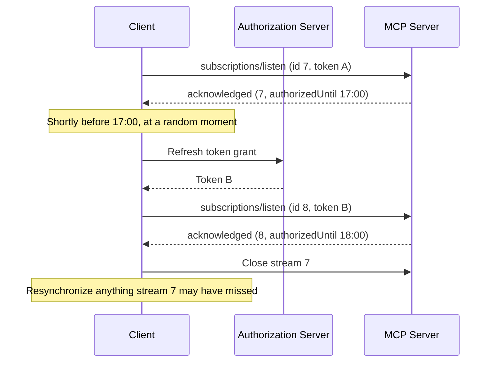

# SEP-XXXX: Authorization Deadline for Subscription Streams

- **Status**: Draft
- **Type**: Standards Track
- **Created**: 2026-10-29
- **Author(s)**: Ramjot Singh (@RamjotSingh)
- **Sponsor**: None (seeking sponsor)
- **PR**: TBD
- **Requires**: [#67][sep-ending] (Ending Subscription Streams When Authorization Ends)
- **Related**: [transports-wg#62][issue-62] (discussion); split from [#63][pr-63]

## Abstract

[Ending Streams][sep-ending] ends a `subscriptions/listen` stream when its authorization expires, but the client learns when only as it happens. This SEP reports the time in the acknowledgment, as `authorizedUntil`, so that a client can refresh its token and open a replacement stream before the old one ends. That narrows the gap in which notifications can be missed, and lets clients spread their reconnections out instead of reconnecting all at once.

## Motivation

Under [Ending Streams][sep-ending], a client finds out that its stream's authorization has expired when the stream ends. It then refreshes its token, opens a new stream, and resynchronizes; whatever changed in between was delivered on neither stream. Every stream that shares a token ends at the same moment, so their clients reconnect together.

A client cannot count on knowing when its own token expires. OAuth recommends, but does not require, that the authorization server report the token's lifetime as `expires_in` ([OAuth 2.1, section 3.2.3][oauth21-token-response]), so whether a client receives it depends on how the authorization server is implemented. Even a client that knows when its token expires does not know when the server will stop delivering: a server can cap stream authorizations by policy, an intermediary can validate tokens on the server's behalf, and the server's clock decides when the stream ends. `authorizedUntil` gives the client the deadline the server itself enforces, rather than a value the authorization server may or may not send. Slack Socket Mode reports `approximate_connection_time` when a connection opens for the same reason ([Slack Socket Mode][slack-socket]).

## Specification

The key words "MUST", "MUST NOT", "REQUIRED", "SHALL", "SHALL NOT", "SHOULD", "SHOULD NOT", "RECOMMENDED", "NOT RECOMMENDED", "MAY", and "OPTIONAL" in this document are to be interpreted as described in BCP 14 ([RFC 2119][rfc2119], [RFC 8174][rfc8174]) when, and only when, they appear in all capitals.

### 1. Scope and definitions

This specification applies where [Ending Streams][sep-ending] applies, and uses its definitions of server, stream authorization, and authorization expiry. `authorizedUntil` is a field of the acknowledgment, a JSON-RPC message; its meaning does not depend on the transport.

- **Authorization deadline**: the time until which the stream authorization lets the server deliver notifications: the authorization expiry, or earlier when a new requirement takes effect ([Ending Streams, section 3][sep-ending-3], rule 3). The server reports it as `authorizedUntil`.

### 2. The deadline in the acknowledgment

1. The acknowledgment MUST include `authorizedUntil`, the authorization deadline, when the server knows it. The field is part of the acknowledgment every client receives; it is not gated by the filter.
2. `authorizedUntil` MUST NOT be later than the authorization expiry.
3. A server ends a stream with `token_expiry` at its `authorizedUntil`, not earlier, and does not add jitter to the deadline. Revocation can still end a stream before its deadline ([Ending Streams, section 4][sep-ending-4]).
4. The acknowledgment reports the deadline known when it was sent. A new requirement that takes effect later can make the deadline earlier ([Ending Streams, section 3][sep-ending-3], rule 3); the stream then ends at the new deadline with `insufficient_authorization`.

Client and server clocks can disagree. A client that schedules from `authorizedUntil` SHOULD leave a margin. On Streamable HTTP, it MAY also estimate the server's clock from the `Date` header of the response that carried the acknowledgment ([RFC 9110, section 6.6.1][rfc9110-date]).

### 3. Re-establishing a stream before its deadline

1. A client MAY open a new stream with the same filter before the old one ends, to narrow the gap, choosing the moment at random within the last minute before the deadline, or within the last 10% of the authorization's lifetime if that is shorter, so that streams whose tokens expire together do not all reconnect at once.
2. The new token MUST outlive the old stream's authorization deadline. A client that cannot obtain such a token (for example, because its authorization server returns a cached token) lets the old stream end, then opens a new stream with a new token.
3. A client MUST NOT have more than one new stream in progress for the same stream, and cancels the old stream once the new one is acknowledged ([Cancellation: Transport-Specific Cancellation][cancel-transport]). It obtains the new token as [Ending Streams, section 6][sep-ending-6] describes: one new token per superseded token, used for every stream it authorized.
4. While both streams are open, notifications can be duplicated or arrive out of order, and clients MUST tolerate both. For task notifications, a client MUST NOT move a task back to an earlier `lastUpdatedAt` or out of a terminal status, and SHOULD deduplicate `inputRequests` by key.
5. After the old stream is cancelled, the client SHOULD resynchronize the state it depends on, as after any re-established stream ([Ending Streams, section 6][sep-ending-6], rule 4).

### 4. Schema changes

Additions to `schema/draft/schema.ts`:

```typescript
export interface SubscriptionsAcknowledgedNotificationParams extends NotificationParams {
  // ...existing fields...

  /**
   * The stream's authorization deadline, as an RFC 3339 UTC timestamp.
   * Present when the server knows it.
   */
  authorizedUntil?: string;
}
```

### 5. Guidance for extensions (non-normative)

An extension that defines a long-lived request of its own, such as `events/stream` in the Events extension ([SEP-3415][sep-3415]), can report the authorization deadline when the request starts, as `authorizedUntil` does in the acknowledgment, so that its clients can replace the request before it ends.

### 6. Changes to specification documents

- **Subscriptions** (`basic/patterns/subscriptions`): add `authorizedUntil` to the acknowledgment, and describe re-establishing a stream before its deadline.
- **Schema** and **Changelog**: the addition above.

### 7. Examples

The acknowledgment of a stream whose token expires at 17:00:

```json
{
  "jsonrpc": "2.0",
  "method": "notifications/subscriptions/acknowledged",
  "params": {
    "_meta": { "io.modelcontextprotocol/subscriptionId": 7 },
    "notifications": {
      "resourceSubscriptions": ["file:///project/config.json"]
    },
    "authorizedUntil": "2026-09-28T17:00:00Z"
  }
}
```

A client that reopens the stream before the deadline:



A client that does nothing sees stream 7 end at 17:00 with `AuthorizationEnded` and reason `token_expiry`, as [Ending Streams][sep-ending] describes.

## Rationale

### Report the deadline the server enforces

A client may not know when its token expires, and cannot know when the server will stop delivering: policy caps, intermediaries, and the server's clock decide that. Reporting the deadline the server enforces makes the end predictable, so that the client can replace the stream at a moment it chooses instead of reacting to the end.

### Report it to every client

`authorizedUntil` is part of every acknowledgment rather than something a client asks for in its filter. Older clients ignore a field they do not know, and a client that understands it can use it without asking for anything.

### Use an absolute deadline

MCP represents points in time as RFC 3339 timestamps, such as `createdAt` and `lastUpdatedAt` in the Tasks extension. A relative duration drifts with every hop, and is ambiguous once a message has been queued. Clients allow for clock skew with a margin, and on Streamable HTTP can estimate it from the `Date` header.

### Reopen at a random moment

Streams authorized by tokens from the same refresh expire together. Replacing each at a random moment within the last minute, or the last tenth of a short lifetime, spreads the reconnections, and keeps a server from receiving every client's new stream in the same second.

### Prior art

- **Slack Socket Mode** reports `approximate_connection_time` when a connection opens, and warns about ten seconds before it closes one ([Slack Socket Mode][slack-socket]).

### Alternatives considered

- **Rely on the token response's `expires_in`.** OAuth recommends it but does not require it, so whether a client receives it depends on the authorization server. Even when it is present, it says nothing of policy caps or an intermediary's view, and it counts from when the token was issued, not from when the stream opened.
- **Warn shortly before the end instead.** A warning needs a channel that does not end the stream, and complements the deadline rather than replacing it: a client that misses the warning still knows when its stream will end.

## Backward Compatibility

The acknowledgment gains an optional field, which older clients ignore. A newer client talking to an older server sees no `authorizedUntil`, and learns of the end when its stream ends, as [Ending Streams][sep-ending] describes.

## Security Implications

- **No new information.** `authorizedUntil` tells the client when its own authorization ends, and carries no credentials.
- **Reconnect storms.** Clients re-establish at a random moment before the deadline, add jitter, and back off.
- **Overlapping streams.** While a client holds two streams for the same filter, it can receive the same notification twice. Both streams carry only what the client is authorized to receive.

## Performance Implications

A client that re-establishes before the deadline briefly holds two streams for each stream it replaces, and spreads its reconnections over the last minute before the deadline.

## Reference Implementation

A [prototype][prototype-a] on a fork of the TypeScript SDK (branch `poc/authorization-lifetime`) implements this SEP. It predates the split: it implements the combined draft in [#63][pr-63], and its test names cite that draft's sections.

- **Server**: [`listenRouter.ts`][router-a] reports `authorizedUntil` from the token's `expiresAt`, capped by the policy limit `maxAuthorizationLifetimeMs`, and omits it when neither is known.
- **Client**: [`client.ts`][client-a] exposes it as `McpSubscription.authorizedUntil`.
- **Tests** ([server][server-tests-a], [client][client-tests-a]): "authorizedUntil equals authInfo.expiresAt and is capped by maxAuthorizationLifetimeMs"; "authorizedUntil is omitted when no token expiry or policy cap is known"; "authorizedUntil from the acknowledgment is exposed on McpSubscription".
- **Demo** ([README][demo-a]): scenario 3, steps 1 and 2. Both acknowledgments carry `authorizedUntil`, and both streams are re-established shortly before the first deadline with one refresh shared between them; the client then cancels the old streams and resynchronizes.

## Testing Plan

Conformance scenarios, for the [conformance repository][conformance]:

**Server, required**

1. Includes `authorizedUntil` in the acknowledgment when the token's expiry is known, no later than that expiry.
2. Ends a stream with reason `token_expiry` no earlier than its `authorizedUntil`, within a stated clock tolerance.

**Client, required**

1. Re-establishes a stream before `authorizedUntil`, at a random moment within the window, using one refresh for all streams that share the token; cancels the old stream once the new one is acknowledged; and resynchronizes.

[issue-62]: https://github.com/modelcontextprotocol/transports-wg/issues/62
[pr-63]: https://github.com/modelcontextprotocol/transports-wg/pull/63
[sep-ending]: https://github.com/modelcontextprotocol/transports-wg/pull/67
[sep-ending-3]: https://github.com/RamjotSingh/transports-wg/blob/sep/ending-streams-when-authorization-ends/proposals/XXXX-ending-streams-when-authorization-ends.md#3-stream-lifetime
[sep-ending-4]: https://github.com/RamjotSingh/transports-wg/blob/sep/ending-streams-when-authorization-ends/proposals/XXXX-ending-streams-when-authorization-ends.md#4-revocation
[sep-ending-6]: https://github.com/RamjotSingh/transports-wg/blob/sep/ending-streams-when-authorization-ends/proposals/XXXX-ending-streams-when-authorization-ends.md#6-re-establishing-a-stream
[cancel-transport]: https://modelcontextprotocol.io/specification/2026-07-28/basic/patterns/cancellation#transport-specific-cancellation
[sep-3415]: https://github.com/modelcontextprotocol/modelcontextprotocol/pull/3415
[slack-socket]: https://docs.slack.dev/apis/events-api/using-socket-mode
[conformance]: https://github.com/modelcontextprotocol/conformance
[oauth21-token-response]: https://datatracker.ietf.org/doc/html/draft-ietf-oauth-v2-1-13#section-3.2.3
[rfc2119]: https://www.rfc-editor.org/rfc/rfc2119
[rfc8174]: https://www.rfc-editor.org/rfc/rfc8174
[rfc9110-date]: https://www.rfc-editor.org/rfc/rfc9110#section-6.6.1
[prototype-a]: https://github.com/RamjotSingh/typescript-sdk/blob/poc/authorization-lifetime/AUTHORIZATION-LIFETIME-PROTOTYPE.md
[router-a]: https://github.com/RamjotSingh/typescript-sdk/blob/poc/authorization-lifetime/packages/server/src/server/listenRouter.ts
[client-a]: https://github.com/RamjotSingh/typescript-sdk/blob/poc/authorization-lifetime/packages/client/src/client/client.ts
[server-tests-a]: https://github.com/RamjotSingh/typescript-sdk/blob/poc/authorization-lifetime/packages/server/test/server/subscriptionLifetime.test.ts
[client-tests-a]: https://github.com/RamjotSingh/typescript-sdk/blob/poc/authorization-lifetime/packages/client/test/client/subscriptionLifetime.test.ts
[demo-a]: https://github.com/RamjotSingh/typescript-sdk/blob/poc/authorization-lifetime/examples/authorization-lifetime/README.md
