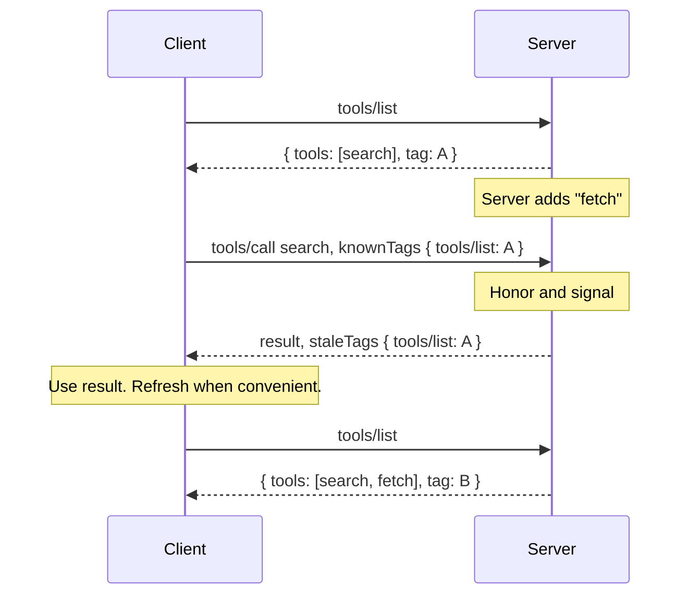
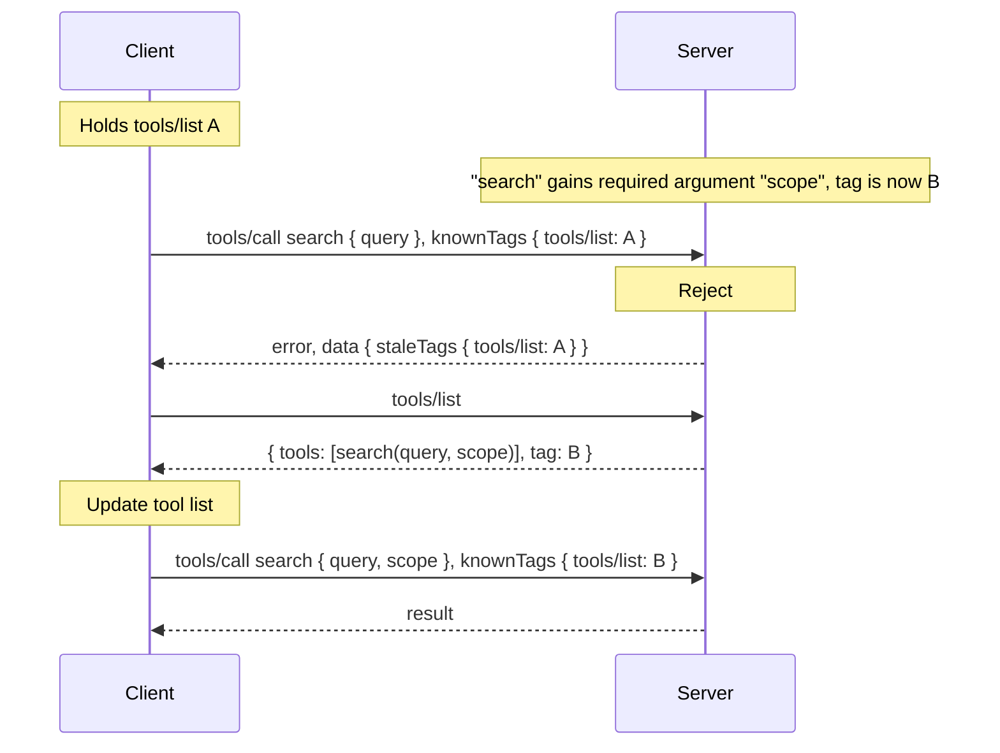

# SEP-XXXX: Definition Tags

- **Status**: Draft (discussion; not an accepted protocol change)
- **Type**: Standards Track
- **Created**: 2026-09-04
- **Author(s)**: TBD
- **Sponsor**: None
- **Related**: [PR #45](https://github.com/modelcontextprotocol/transports-wg/pull/45), [SEP-2549](https://github.com/modelcontextprotocol/modelcontextprotocol/pull/2549), [SEP-2640](https://modelcontextprotocol.io/seps/2640-skills-extension) (skills)
- **Schema fragment**: [`XXXX-definition-tags.ts`](XXXX-definition-tags.ts)

## Abstract

This SEP lets MCP Servers supply a *definition tag* with their CacheableResults: an opaque string that changes whenever the definitions in the result do.

Clients must return tags to the MCP Server, which can serve the call, serve it and flag that definitions have changed, or reject it if the tag is not serviceable.

The mechanism is advisory. Servers choose whether to supply tags and what to do with the ones they receive.

Extensions that define their own lists (`skills/list` for example) can participate using the same structure.

## Motivation

Hosts that cache Tool Lists can call tools after the Server has changed them. The `2026-07-28` specification `ttlMs` adds a "freshness hint, not a guarantee" and notes that:

> Servers MAY change the underlying data before TTL expires.

Tool definitions can change for many reasons; deployments, permissions, feature flags and user settings. Hosts can make tool call requests against stale schemas. Often standard validation will catch mismatches, but in pathological cases description and argument semantics may change and the model may issue tool calls that weren't intended.

The tag mechanism gives a server four options:
- **Ignore:** the request is handled exactly as today.
- **Honor:** the request is served against the definitions the tag describes, so in-flight call sequences and tasks finish against the tool set they started with.
- **Honor and signal:** as above, and the response tells the client to refresh when convenient.
- **Reject:** an error says which definitions are stale, before anything runs.

*Authors note: "Honor" may be difficult or SDK dependent, since the server must hold more than one request shape for the same tool or prompt identity.*

The mechanism works alongside the existing `ttlMs` hint. Clients can call optimistically within the TTL and let the server catch changes the TTL did not predict.

### Use Cases

The scenarios below describe how this feature is expected to be used.

**Server**

- **Deployments.** During a rolling deploy, successive requests from one client can land on new and old instances. With tags, an instance that receives a request built against the other version's definitions can honor it, flag it, or reject it before anything runs, instead of silently misinterpreting the arguments. Rejecting is best avoided here: if a client's refresh and its retry reach instances on different versions, it can be rejected repeatedly and fall into a retry storm. During deployment, servers should prefer honor or honor-and-signal, or use the tags to route clients to an appropriate instance.

- **Versioning.** A server that wants to evolve its tool surface can keep more than one definition set live and use the known tag to select the one a client is working from. Clients migrate to the new set when they refresh, rather than the moment it is deployed.

- **Task draining.** A long-running task or multi-step call sequence may span a definition change that would break it midway. Honoring the tag the sequence started with lets the server finish the work against the original definitions, then retire them once nothing depends on them.

**Client**

- **Optimistic Caching.** A client can call tools from cached definitions immediately, without requiring a `tools/list` round trip. If the definitions are stale, the server says so when a tool is called, and only then does the client refresh. There's no waiting for `ttlMs` to run out, no need for poll/subscribe and no risk of silent definition drift. 

- **Specific errors.** Without tags, a schema change surfaces as an argument validation failure. A tag rejection names the stale method instead, so the client can tell a changed definition from a bad call and refresh.

- **Long-lived clients.** A client can keep using the same server for weeks or months without subscribing to change notifications. The tags it sends on each call are enough for the server to tell it when a refresh is needed.

- **Continuous Deployment.** A server can offer new definitions to a cohort of clients through "honor and signal", while honouring existing tags. This allows the server to widen the rollout based on live success criteria.

**Pattern: progressive disclosure via a search tool**

- A server can expose a small initial tool set with a `search` (or similar discovery) tool, enabling further tools based on what the client searches for. The search result carries `staleTags` naming `tools/list` (with the tag the client sent, or `null` if it sent none), which tells the client the catalogue has grown; it refreshes and updates the tool list it presents to the model.

## Specification

The key words **MUST**, **MUST NOT**, **SHOULD**, and **MAY** are to be interpreted as described in [BCP 14](https://www.rfc-editor.org/info/bcp14).

### The `tag` field

`CacheableResult` gains one optional field, `tag`, carrying the result's definition tag. The rest of this document says "tag" for short:

```ts
export interface CacheableResult extends Result {
  ttlMs: number;
  cacheScope: "public" | "private";
  /**
   * An opaque, deterministic identifier for the definitions this result
   * describes. Changes whenever they do.
   */
  tag?: string;
}
```

A result carries at most one tag. It covers the result payload with the envelope removed: everything except `resultType`, `_meta`, `ttlMs`, `cacheScope`, `tag`, and `nextCursor`. For a list, it covers the complete collection the caller can see, not the page in hand. The tag is identified by the method that produced it:

| Method | Tag covers |
|---|---|
| `server/discover` | `instructions`, `capabilities`, and `supportedVersions` together |
| `tools/list` | the complete tool list |
| `prompts/list` | the complete prompt list |
| `resources/list` | the complete resource list (descriptors, not contents) |
| `resources/templates/list` | the complete template list |
| `resources/read` | nothing; servers omit the field |
| an extension list, e.g. `skills/list` | as the extension defines |

An extension that defines a list operation and mirrors `ttlMs` and `cacheScope`, as `skills/list` does, **SHOULD** mirror `tag` the same way. A skills tag covers the catalog entries, not the files they point to, which already carry their own content digests.

A tag **MUST** be deterministic and collision-resistant. Adding, removing, or changing a definition changes it. Ordering, page size, cursors, and TTL do not. An empty collection still has a tag.

Clients **MUST** treat tags as opaque strings and compare them only for equality.

Tags never extend a TTL. A client **MUST** still refresh when a TTL expires; a stale signal can only make a refresh happen sooner.

A server **MUST** compute a tag using the same authorization and tool-selection context it uses to produce the result it sits on.

```json
{
  "resultType": "complete",
  "tools": [],
  "ttlMs": 60000,
  "cacheScope": "private",
  "tag": "sha256:..."
}
```

### Pagination

The [caching rules](https://modelcontextprotocol.io/specification/draft/server/utilities/caching) cache each page separately, keyed by cursor, with its own TTL and no cross-page consistency guarantee. The tag describes the *collection*, not the page.

- A server **SHOULD** return the same tag on every page. A server paging live data returns the tag as of each page, which may differ.
- A client **MUST NOT** combine pages with different tags. On a mismatch, whether between pages or from the server, it discards every page for that collection and starts again without a cursor.

### Sending known tags

A client **SHOULD** tell the server which tags it is working from, in the request `_meta`, as a map from the method that produced each tag to the tag:

```ts
export interface KnownTags {
  "server/discover"?: string;
  "tools/list"?: string;
  "prompts/list"?: string;
  "resources/list"?: string;
  "resources/templates/list"?: string;
  /** Extension list methods, e.g. "skills/list". */
  [method: string]: string | undefined;
}

export interface RequestMetaObject extends MetaObject {
  // Existing fields unchanged.
  "io.modelcontextprotocol/knownTags"?: KnownTags;
}
```

For example, the parameters of a `tools/call` request might look like this (other required `_meta` fields are omitted):

```json
{
  "name": "search",
  "arguments": { "query": "datasets" },
  "_meta": {
    "io.modelcontextprotocol/knownTags": {
      "tools/list": "sha256:...",
      "server/discover": "sha256:..."
    }
  }
}
```

Known tags are hints, not preconditions. No capability flag is required.

On `tools/call`, `prompts/get`, `resources/read`, `server/discover`, and an extension's equivalent operations, a client **SHOULD** send every tag it holds. This is the simplest rule for clients: they do not need to work out which collections an operation depends on, and the server sees every tag it might want to check or signal.

### Handling known tags

A server that receives known tags on `tools/call`, `prompts/get`, `resources/read`, or an extension's equivalent has four choices:

- **Ignore.** The request is handled exactly as it would be without hints.
- **Honor.** If the server still holds the definitions a known tag describes, it **MAY** serve the request under those definitions. This lets call sequences and tasks finish against the tool set they started with.
- **Honor and signal.** As above, but the server names the stale methods in result `_meta`, with the tags it found stale, so the client knows to refresh. The client **SHOULD** do so when convenient (for example after the model returns an `END_TURN` stop reason) and **MUST NOT** treat the result as an error or retry the request.
- **Reject.** If a known tag does not match and the server will not honor it, the server rejects the request as stale.

Signal and reject carry the same map, `staleTags`, keyed by method. Each value is the tag the client sent for that method that did not match, or `null` when the server reports a change for a method the client sent no tag for. It **MUST NOT** contain a current tag. In a result it goes in `_meta`; in a rejection it goes in error `data`.

```ts
/** Method -> the stale tag the client sent, or null if it sent none. */
export type StaleTags = { [method: string]: string | null };

export interface ResultMetaObject extends MetaObject {
  // Existing fields unchanged.
  "io.modelcontextprotocol/staleTags"?: StaleTags;
}
```

```json
{ "_meta": { "io.modelcontextprotocol/staleTags": { "tools/list": "sha256:A..." } } }
```

```json
{ "staleTags": { "tools/list": "sha256:A...", "skills/list": "sha256:C..." } }
```

Echoing the client's own tag lets it resolve responses that cross a refresh. A client compares each string value with the tag it now holds for that method: if they differ, it has already refreshed past that tag and ignores the entry; if they are equal, it refreshes. A `null` value always means refresh.

Because clients send all known tags, a request will often carry tags for collections the operation does not use. A server **MUST NOT** reject a request for a stale tag unless the operation depends on that collection; it **MAY** name the tag in `staleTags` on the result instead. A stale `prompts/list` tag does not fail a `tools/call`. The `server/discover` tag counts for every operation, since instructions shape how the model uses everything else. `resources/read` depends on both `resources/list` and `resources/templates/list`, since the URI may have been built from a template.

A server **MUST NOT** reject `server/discover` for a stale tag. It **MAY** name stale list tags in `staleTags` on the result.

A server **SHOULD** validate the tag before operation-specific validation and execution so that a changed schema is reported as stale rather than invalid arguments.

A standard error code needs to be allocated before this SEP is finalized; this draft does not propose a numeric code or an HTTP status.

A client receiving this error **SHOULD** refresh the affected definitions and then decide whether the operation still makes sense. Refreshing means fetching from the server: the client **MUST NOT** copy a new tag without also fetching the definitions.

## Rationale

**Per collection, not per primitive.** An earlier draft tagged each primitive and made the check mandatory. It could not detect added primitives, and every replica had to honor every advertised tag. A collection tag covers additions and removals and is cheaper to compute. Any change to a collection invalidates requests against it, even when the tool being called is unchanged. Draining still works: a server honoring an old tag holds the whole old collection.

**Tags on lists.** List results contain the full definitions of tools, prompts, and templates. There is no separate per-primitive fetch, so the list is the only thing to tag.

**Per collection, not per server.** Tools, prompts, and resources each have their own `list_changed` notification, `CacheableResult`, and fetch. A single server-wide tag would make a client re-fetch every list when any one changes, and would fold extension lists into a value they do not control.

**No tag on `resources/read`.** `resources/list` returns descriptors; contents are fetched by URI. Contents are data, not definitions, and their freshness is covered by `ttlMs`, per-URI subscriptions, and HTTP ETags. A content tag would also need a per-URI key in `KnownTags`, and a client sending all its tags would send one per resource read. `resources/read` sends known tags but does not carry one.

**A field on `CacheableResult`.** Results that carry `ttlMs` and `cacheScope` are the results this SEP tags, so `tag` sits alongside them. `Result` already allows additional properties, so servers can send `tag` before the schema names it.

**Keyed by method.** The method identifies what a tag covers, so the tag itself needs no structure. `server/discover` tags only what discovery returns. A client that sends its list tags on `server/discover` learns which lists are stale; an empty `staleTags` does not confirm the rest, since servers may ignore hints. Extension methods such as `skills/list` use the same map without a naming rule.

**Cost of checking.** Checking a request requires the tag of the whole collection, which may cost more than the request itself. A server can supply tags only where the collection is cheap to build and ignore hints elsewhere.

**Echoing the stale tag.** With a plain list of methods, a client with requests in flight cannot tell whether a late `staleTags` refers to a tag it has already replaced. Echoing the tag the client sent resolves this without per-request tracking. It returns nothing the client did not send, so it does not conflict with the rule against returning current tags, which exists so that a client cannot adopt a tag without fetching its definitions.

**Naming.** Earlier drafts used *digest*. The skills extension uses `digest` for a verifiable content hash; a tag is opaque and compared only for equality. *Version* is already used for `Implementation.version`, `supportedVersions`, and protocol revisions, and implies an ordering. The wire names are `tag`, `knownTags`, and `staleTags`.

**Separate from HTTP caching.** A tag identifies definitions; an ETag identifies an HTTP representation of a page. Keeping them separate keeps this SEP transport-independent and leaves ETags to the HTTP retrieval proposal.

## Backward Compatibility

This SEP adds optional fields and does not change the behavior of existing requests. Clients can ignore the tag. Servers can ignore known tags, including after supplying them. Implementations that do not recognize the new fields continue to work as they do today.

## Security Implications

A tag carries the same confidentiality and authorization context as the definitions it describes. For example, a tool list may be identical for many users while instructions name the individual user; the `server/discover` result is then private to that user even though the `tools/list` result might not be. Tags grant no access. They do not prove that a server's implementation is unchanged, only its advertised definitions, and a server that honors an old tag still enforces current permissions.

The same care applies to the cache scope of a result carrying a tag. A result may be marked `public` only if every caller would receive the same result, not merely if it contains no user data. For example, an anonymous caller asking for the tool list might receive three tools, while a signed-in caller making the same request should receive five, because two of the tools require sign-in. The anonymous list contains no user data, but it is not public: if the two callers share a cache, the signed-in caller is served the shorter list without reaching the server, and their known tags then fail to match.

## Reference Implementation

The [HF MCP server](https://github.com/huggingface/hf-mcp-server) implements the response field, the request map (under the application key `huggingface.co/known-digests`), and the rejection path as described here. It predates the rename from "digest" to "tag" and still uses the earlier wire names (`digest`, `staleDigests`), and its stale list is a plain list of methods rather than a map.

- It tags `tools/list` and `server/discover` (instructions only, so far), and checks known tags on `tools/call` only.
- A mismatch is rejected before tool lookup, argument validation, or execution, with the application error code `-32987` (outside JSON-RPC's reserved range) and `data: { "staleDigests": [...] }`. Unknown keys and non-string hints are ignored.
- Tags are supplied only where the complete tool list is cheap to build: anonymous requests and requests for a named, fixed set of tools. Other requests get no tag, their hints are ignored, and they keep the existing single-tool fast path. Tagged results also carry `private` TTL cache hints; anonymous lists are not `public`, because they omit tools that require sign-in.
- Tools are sorted by name, each tool's own `_meta` is included, and canonicalized JSON is hashed with SHA-256. Result-envelope metadata is excluded. For testing, a deploy-wide or runtime salt changes every tag without changing definitions, forcing clients through the mismatch path.

Client integration in [fast-agent](https://github.com/evalstate/fast-agent) is in progress. It is optimistic: it sends known tags with each call and refreshes definitions when a call is rejected.

### Testing Plan

Implementations should test:

- Tags are deterministic, and change when definitions change.
- Empty collections have tags, and absent instructions differ from empty instructions.
- Tags are unaffected by ordering, page size, cursor, and TTL.
- Every page of a snapshot listing carries the same tag; a change mid-pagination is reflected on later pages.
- A client discards all pages when any page disagrees, and when the server reports a mismatch.
- Existing result fields and `_meta` are preserved.
- Tags are isolated between callers with different authorization contexts.
- Requests are handled normally when hints are absent or ignored.
- When checking is enabled, stale requests are rejected before any side effect.
- When honoring is enabled, a request carrying an old tag runs against the old definitions, and one carrying an unknown tag is rejected.
- When signaling, the result names each stale method with the tag the client sent (or `null` if it sent none) and never a current tag; the client uses the result and refreshes before its next dependent call.
- A client that has already refreshed ignores a `staleTags` entry whose value differs from the tag it now holds, and always refreshes on `null`.
- Methods the server does not tag, extension methods, and malformed hints do not cause a rejection.
- A stale tag for a collection the operation does not depend on is signaled, not rejected.
- `server/discover` with stale tags is signaled, never rejected.
- After a mismatch, the client refreshes from the server rather than from a still-fresh cached list.

## Open Questions

- Whether the `server/discover` tag should cover `supportedVersions` and `capabilities` along with `instructions`. This draft says yes, on the rule that a tag covers the payload minus the envelope, so the same rule serves extension results.
- How long a server that honors old tags should keep them, and whether it should say so. This draft leaves it to the server.
- How the skills extension (or any extension whose listing may be deliberately partial) should define its tag, given that "the complete set the caller can see" is then the set the server chooses to enumerate.
- The canonicalization, and which definition fields a tag covers (for example, whether a tool's own `_meta` is included).
- Whether servers must provide a consistent snapshot across pages or may require clients to restart.
- The standard error code for a tag mismatch.

## Appendix: Scenarios

Each scenario describes behavior without tags, then with tags. Tags are written `A` (before the change) and `B` (after). Notifications are via `subscriptions/listen`.

### Adding a tool

Without tags, the client learns of the new tool when its `tools/list` TTL expires or, if subscribed, on `notifications/tools/list_changed`.

With tags, the next request carrying `tools/list: A` reaches a server whose tag is `B`. The call to `search` is unaffected by the change, so the server honors and signals: it serves the call and names `tools/list: A` in `staleTags`. The client refreshes when convenient and updates the tool list it presents to the model.



### Removing a tool

Without tags, a call to the removed tool fails with `-32602` "Unknown tool". The client cannot tell whether the tool was removed or the model named it wrongly.

With tags, the server rejects the call as stale with `staleTags { tools/list: A }`. The client refreshes and updates the tool list it presents to the model. Calls to tools that still exist can be served and signaled, as for an added tool. A server still draining work against `A` may honor the call instead.

A renamed tool is a removal and an addition.

### Updating a tool definition

Without tags, a changed `inputSchema` surfaces as an input validation error (`isError: true`), not as a changed definition. If only the description or the meaning of an argument changed, the call passes validation and runs under the new meaning.

With tags, the server checks the tag before validating arguments and rejects with `staleTags { tools/list: A }`. The client refreshes and updates the tool list it presents to the model. Whether the call is retried is up to the client. A server that still holds `A` may honor the call against the old definition instead.



Changes to `outputSchema` or annotations are handled the same way. Whether a tool's `_meta` is covered is an open question.

### Changing a prompt

Without tags, a changed or removed argument fails `prompts/get` with `-32602`. A changed description is not detected.

With tags, `prompts/get` carries `prompts/list: A`. The server rejects or honors as for tools. On rejection the client refreshes and updates the prompts it presents.

### Changing instructions

Without tags, the client sees new instructions when its `server/discover` TTL expires and it calls again.

With tags, any request carrying `server/discover: A` may be signaled or rejected. The client calls `server/discover` and updates the instructions it presents to the model.

### Starting from a cached list

Without tags, a client with lists still within their TTL uses them and finds changes by request failure, TTL expiry, or notification.

With tags, the client sends all held tags on `server/discover`. The server names any stale lists in `staleTags`, and the client refreshes only those. An empty `staleTags` does not extend a TTL.

### Rolling deployment

Without tags, a client's requests can reach old and new instances, and requests built against one version are validated or interpreted by the other.

With tags, an instance that holds the other version's definitions honors and signals. An instance that does not should ignore the tag rather than reject, unless the deployment is being rolled back, to avoid repeated refreshes as requests alternate between instances.
