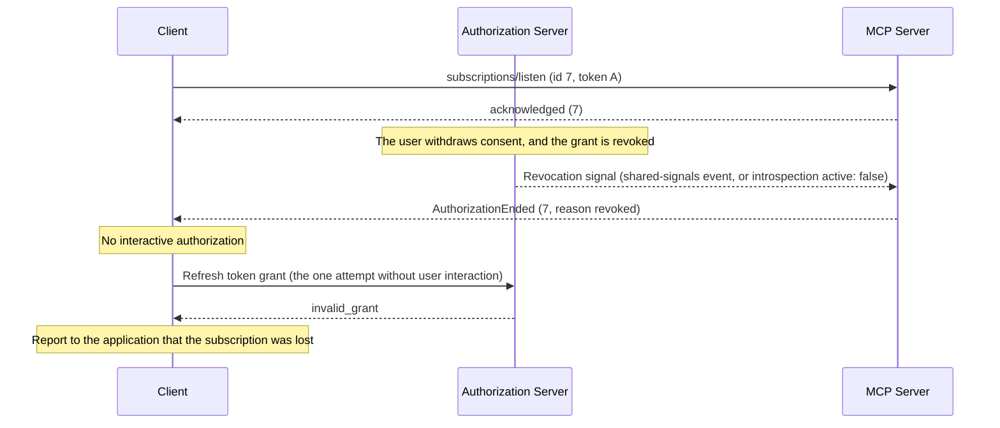
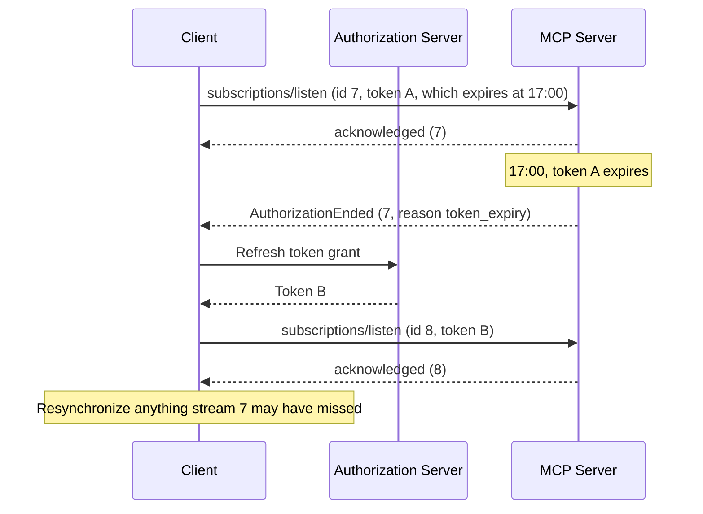
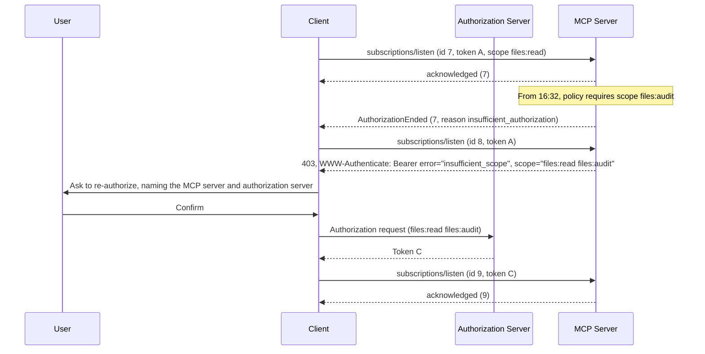

# SEP-XXXX: Ending Subscription Streams When Authorization Ends

- **Status**: Draft
- **Type**: Standards Track
- **Created**: 2026-10-29
- **Author(s)**: Ramjot Singh (@RamjotSingh)
- **Sponsor**: None (seeking sponsor)
- **PR**: TBD
- **Related**: [transports-wg#62][issue-62] (discussion); split from [#63][pr-63]

## Abstract

MCP authorizes each HTTP request with an access token, but a `subscriptions/listen` stream is one request that can stay open for hours. The specification does not say what happens when the token behind a stream expires, is revoked, or stops meeting the server's policy, so a stream opened with a five-minute token can keep delivering change notifications and task results indefinitely.

This SEP bounds each stream by its authorization:

- A server MUST NOT write notifications to a stream after the stream's access token expires, or after it learns that the token or the grant behind it has been revoked, whatever protocol version the client uses.
- When the server's policy comes to require more than the token provides, such as an additional scope or more recent authentication, the server stops delivering what needs the new requirement.
- It ends a stream for these reasons with a new `AuthorizationEnded` error whose `reason`, `token_expiry`, `insufficient_authorization`, or `revoked`, tells the client whether to refresh its token, involve the user, or stop. Clients on older protocol versions see the stream close without a response.

It is the first of a series of proposals on the lifetime of subscription streams ([#62][issue-62]). Later proposals in the series report the deadline in advance, and let clients that opt in keep a stream across its deadline.

## Motivation

### Streams outlive the authorization they were opened with

The authorization specification requires an access token on every HTTP request, requires servers to reject expired tokens with `401 Unauthorized` ([Authorization: Access Token Usage][auth-token-usage]), and recommends short-lived access tokens "to reduce the impact of leaked tokens" ([Authorization Security Considerations: Token Theft][auth-token-theft]).

`subscriptions/listen` sits outside both rules. It is "a single long-lived POST-response stream" ([2026-07-28 changelog][changelog]), so its token is checked once, when the stream opens, and the specification sets no lifetime for it. The server "delivers `notifications/resources/updated` on the resulting stream whenever a watched resource changes" ([Resources: Subscriptions][resources-subs]). The TypeScript SDK checks the token in middleware when the stream opens, and then delivers every change that matches the acknowledged filter ([TypeScript SDK: listen router][ts-listen-router]). As a result:

- A stolen five-minute token can open a stream that keeps receiving change signals for as long as the connection holds.
- A stream keeps delivering after its token, or the grant behind it, has been revoked.
- With the Tasks extension, `notifications/tasks` carries complete task results on the same stream ([SEP-2663: Task Status Notifications][sep-2663-notifications]).

HTTP cannot carry the missing signal. A stream's status line and headers are sent when it starts, so a server cannot answer an open stream with `401`. The only channel left is a JSON-RPC message on the stream.

### Policy can change while a stream is open

Servers change what they require. A tenant starts requiring a `files:audit` scope so that access is recorded, or a recent sign-in before sensitive data is shown. Requests made after the change are refused with `403` and an `insufficient_scope` challenge ([Authorization: Step-Up Authorization Flow][auth-stepup]), but a stream opened before it keeps delivering under the old terms.

### Clients cannot tell what a closed stream means

A server that enforces a lifetime today can only close the stream, with the completion result or with no response at all ([Subscriptions: Graceful Closure][subs-graceful]). The client cannot tell whether it needs a fresh token, the user's help, or nothing. It reconnects, is rejected with `401` or `403`, and only then learns what is needed. When access is gone for good, it may keep retrying, or keep prompting the user.

## Specification

The key words "MUST", "MUST NOT", "REQUIRED", "SHALL", "SHALL NOT", "SHOULD", "SHOULD NOT", "RECOMMENDED", "NOT RECOMMENDED", "MAY", and "OPTIONAL" in this document are to be interpreted as described in BCP 14 ([RFC 2119][rfc2119], [RFC 8174][rfc8174]) when, and only when, they appear in all capitals.

### 1. Scope

This specification applies to `subscriptions/listen` requests authorized with an MCP access token, which today means requests on Streamable HTTP. It does not apply to stdio, where implementations "SHOULD NOT follow this specification, and instead retrieve credentials from the environment" ([Overview: Auth][overview-auth]). Bounded requests, such as `tools/call`, are out of scope even when their response is streamed; their authorization is evaluated when the request is received. [Section 9](#9-guidance-for-extensions-non-normative) is non-normative guidance for extensions that define long-lived requests of their own.

The `AuthorizationEnded` error is a JSON-RPC message, and its meaning does not depend on the transport. On Streamable HTTP, a server MUST send it with HTTP status `200`, and a client acts on the JSON-RPC message, not on the status. The token errors that the Authorization specification defines over HTTP are unchanged: `401` for a token that is missing, invalid, or expired, and `403` with an `insufficient_scope` challenge for a token that lacks a scope ([Authorization: Error Handling][auth-errors]).

### 2. Definitions

- **Server**: the MCP server together with any intermediary, such as an API gateway, that validates access tokens on its behalf.
- **Stream authorization**: the access token presented on the request that opened a `subscriptions/listen` stream, together with the authorization decisions the server derived from it, such as the principal, the client, and the granted scopes.
- **Authorization expiry**: the earlier of (a) the access token's expiry time as known to the server, for example from the `exp` claim of a JWT access token ([RFC 9068][rfc9068]) or from token introspection ([RFC 7662][rfc7662]), and (b) any shorter lifetime that the server's authorization policy imposes on stream authorizations.
- **Revocation**: the end of a stream authorization before its expiry, because the authorization server revoked the access token or the grant behind it, or because the server's own policy withdrew it.

All times in this specification are RFC 3339 timestamps in UTC ([RFC 3339][rfc3339]).

### 3. Stream lifetime

1. A server MUST NOT write notifications to a stream after the stream's authorization expiry, whatever protocol version the stream's client uses.
2. A server MUST NOT write notifications to a stream after it learns that the stream's authorization has been revoked ([section 4](#4-revocation)), whatever protocol version the stream's client uses.
3. When the server's policy comes to require more than the stream authorization provides, such as additional scopes or stronger or more recent authentication, the server MUST NOT write notifications that require it once the requirement takes effect. When the requirement applies to everything the stream carries, the server ends the stream when the requirement takes effect, with reason `insufficient_authorization` ([section 5](#5-ending-a-stream-for-authorization-reasons)); when it applies to only part of what the stream carries, the server drops the notifications that need it, and the stream continues. A server MAY give clients time to meet a new requirement before it takes effect, and a requirement withdrawn before it takes effect changes nothing.
4. When an intermediary validates access tokens and the component holding the stream cannot see them, the deployment MUST still meet rules 1 to 3. Either the intermediary ends streams itself, or it passes the validated expiry, and any revocation it detects, to the component holding the stream. When no component knows a stream's authorization expiry, the server SHOULD limit each stream authorization to a maximum lifetime by policy, and treat that as the authorization expiry.
5. The server drops the notifications that rules 1 to 3 keep off a stream. It MUST NOT write them to any other stream or subscription.

Servers that end streams for operational reasons, such as shutdown or load balancing, continue to use the completion result described in [Subscriptions: Graceful Closure][subs-graceful].

### 4. Revocation

A token can stop being valid before it expires: the user signs out or withdraws consent, an administrator disables the account, or the authorization server detects a compromise. How a server learns of it depends on the deployment.

1. A server MUST act on the revocation signals it receives without undue delay: it stops writing notifications to the streams the revocation affects, and ends them with reason `revoked` ([section 5](#5-ending-a-stream-for-authorization-reasons)). Such signals include a token introspection response with `active: false` ([RFC 7662][rfc7662]), a shared-signals event such as a revoked session, and the server's own policy decisions.
2. A server is not required to look for revocation. It MAY evaluate a stream's authorization lazily, when it writes a notification and at the authorization expiry. A server that can re-validate tokens, for example by introspection, MAY also do so periodically.

The guarantee is bounded by what the server knows. A server that validates self-contained tokens locally, or cannot reach the service it would ask, may not learn of a revocation before the token expires; [section 3](#3-stream-lifetime), rule 1 still ends the stream then. Deployments that need faster revocation combine short-lived tokens with introspection or a shared-signals feed.

A stream whose principal withdraws consent:



```json
{
  "jsonrpc": "2.0",
  "id": 7,
  "error": {
    "code": -32028,
    "message": "Authorization ended",
    "data": { "reason": "revoked" }
  }
}
```

### 5. Ending a stream for authorization reasons

A stream that ends for authorization reasons ends with one final message: the `AuthorizationEnded` error.

**Server rules**

1. A server ends a stream for authorization reasons at its authorization expiry, when its authorization is revoked ([section 4](#4-revocation)), and when a new requirement that covers everything the stream carries takes effect ([section 3](#3-stream-lifetime), rule 3). It MUST then send an `AuthorizationEnded` error response to the `subscriptions/listen` request as the last message on the stream, and close the stream. The error replaces the completion result. If the stream can no longer be written, the server closes it without a response.
2. `error.data` carries `reason` (REQUIRED):

   | `reason`                     | Meaning                                                                                                                                          | Client action                                                                                                                                                                       |
   | ---------------------------- | ------------------------------------------------------------------------------------------------------------------------------------------------ | ----------------------------------------------------------------------------------------------------------------------------------------------------------------------------------- |
   | `token_expiry`               | The stream's authorization expired.                                                                                                              | Obtain a fresh token for the same resource and scopes, normally without user interaction, and re-establish the stream.                                                              |
   | `insufficient_authorization` | The server now requires more than the stream authorization provides: additional scopes, stronger or more recent authentication, or other claims. | Re-establish the stream with the current token; the `401` or `403` response says what is required. Meet it, subject to [section 7](#7-user-consent-and-safety), and try again.      |
   | `revoked`                    | The stream's authorization has been revoked, and new credentials from the same grant are not expected to help.                                   | MUST NOT start interactive authorization because of this reason. MAY make one attempt to reopen with a token obtained without user interaction. Report the loss to the application. |

3. While it can still return an HTTP status, a server rejects a request that its token does not authorize with `401` or `403`, as the Authorization specification requires. Once the HTTP response has been committed, it uses `AuthorizationEnded` instead, even if it has not yet sent the acknowledgment. A server MUST NOT use `AuthorizationEnded` when it can still return an HTTP status.
4. A server MUST NOT send `AuthorizationEnded` in response to a request whose protocol version predates the revision that defines it. For such requests it closes the stream without a response, which those clients treat as an unexpected disconnect. [Section 3](#3-stream-lifetime) still applies.
5. A server MUST NOT send `notifications/cancelled` for a stream it ends this way. The error response is the end signal on every transport, as the completion result is. The Cancellation page currently says otherwise; a fix is pending ([#3348][issue-3348]).

```json
{
  "jsonrpc": "2.0",
  "id": 7,
  "error": {
    "code": -32028,
    "message": "Authorization ended",
    "data": { "reason": "token_expiry" }
  }
}
```

**Client rules**

1. The client acts on `reason`, subject to [section 7](#7-user-consent-and-safety), with backoff, jitter, and the retry limits of the step-up flow ([Authorization: Step-Up Authorization Flow][auth-stepup]). It MUST treat an unrecognized `reason` as `token_expiry`.
2. Notifications may have been lost. After its new stream is acknowledged, the client SHOULD resynchronize any state it derives from them, as it would after any unexpected disconnect; for example by listing tools, prompts, or resources again, reading subscribed resources again, or calling `tasks/get` for the tasks it follows.
3. A client that has already opened a new stream in its place SHOULD ignore the error.

A stream can therefore end in three distinguishable ways:

| How the stream ends                  | Meaning                                                                                               | Client action                                                               |
| ------------------------------------ | ----------------------------------------------------------------------------------------------------- | --------------------------------------------------------------------------- |
| Result with `resultType: "complete"` | The server ended the subscription for an operational reason, such as shutdown.                        | MAY open a new stream. The result alone never justifies prompting the user. |
| `AuthorizationEnded` error           | The stream's authorization ended or changed; `reason` says how.                                       | Act on `reason`, open a new stream if appropriate, and resynchronize.       |
| Transport closes with no response    | Unexpected disconnect, or a stream at an older protocol version that ended for authorization reasons. | MAY reconnect.                                                              |

### 6. Re-establishing a stream

A client that wants to keep receiving notifications opens a new `subscriptions/listen` stream with the same filter when its stream ends.

1. The client obtains credentials as the reason requires ([section 5](#5-ending-a-stream-for-authorization-reasons)).
2. A client SHOULD obtain at most one new token per superseded token, and SHOULD use it for every stream authorized by the superseded token. Concurrent refreshes can trigger the reuse detection that applies to rotated refresh tokens ([OAuth 2.1, section 4.3.1][oauth21-refresh]), which may revoke the whole grant.
3. If a new stream ends with the same reason shortly after opening, the client MUST back off.
4. Notifications sent between the old stream ending and the new one being acknowledged can be missed. After the new stream is acknowledged, the client SHOULD resynchronize the state it depends on ([section 5](#5-ending-a-stream-for-authorization-reasons), client rule 2).

### 7. User consent and safety

A `401` answers something the client just did; an error on a stream arrives without any action by the user. A compromised or malicious server could use such errors to prompt the user repeatedly. Clients therefore follow these rules:

1. An error on a stream MUST NOT by itself start interactive authorization. It can only lead the client to send a request, and interactive authorization then follows only from that request's `401` or `403` response, as the Authorization specification defines. Without a user present, or a policy configured in advance, a client MAY only refresh its token for the same resource and the scopes already granted.
2. Before interactive re-authorization that follows an error on a stream, a client MUST get explicit confirmation from the user that names the MCP server and the authorization server. It SHOULD wait until the user next interacts with that server, and SHOULD rate-limit both prompts and silent refreshes.
3. Scope increases requested after such an error SHOULD be limited to what the stream's filter needs. Clients SHOULD treat a challenge for unrelated scopes as suspect.
4. When a client gives up, because retries are exhausted or credentials cannot be obtained, it MUST report to the application that the subscription was lost and needs action.

### 8. Schema changes

Additions to `schema/draft/schema.ts`:

```typescript
/**
 * A long-lived request ended for authorization reasons: its authorization
 * expired, was revoked, or no longer meets the server's requirements. In the
 * core protocol it is sent as the final response on a subscriptions/listen
 * stream.
 *
 * @category Errors
 */
export const AUTHORIZATION_ENDED = -32028;

/**
 * Why a stream's authorization ended or needs attention. Clients treat
 * unrecognized values as "token_expiry".
 *
 * @category Authorization
 */
export type AuthorizationReason =
  "token_expiry" | "insufficient_authorization" | "revoked" | string;

/**
 * Sent as the final response on a subscriptions/listen stream that the server
 * ends for authorization reasons.
 *
 * @category Errors
 */
export interface AuthorizationEndedError extends Omit<
  JSONRPCErrorResponse,
  "error"
> {
  error: Error & {
    code: typeof AUTHORIZATION_ENDED;
    data: { reason: AuthorizationReason };
  };
}
```

`-32028` is provisional: it is the first code in the range reserved for the MCP specification ([Overview: Error Codes][overview-errors]) after the five that [SEP-3415][sep-3415] requests, and the final number is assigned when the SEP is accepted.

### 9. Guidance for extensions (non-normative)

An extension can define a long-lived request of its own, such as `events/stream` in the Events extension ([SEP-3415][sep-3415]), which delivers the events of one subscription on one request. Such a request outlives its token as `subscriptions/listen` does, and the extension can apply this SEP to it:

- When the request's authorization expires, is revoked, or no longer meets a new requirement, end the request as [section 5](#5-ending-a-stream-for-authorization-reasons) describes: with `AuthorizationEnded` and its reason as the final response. Clients then handle the end of every long-lived request in the same way.
- Apply the consent rules of [section 7](#7-user-consent-and-safety) to that error, and to any similar signal that the extension delivers over its own channels, such as a webhook.

A subscription that the server holds without an open request, such as a webhook subscription, also outlives the token that created it; bounding it is outside this SEP.

### 10. Changes to specification documents

- **Subscriptions** (`basic/patterns/subscriptions`): add sections on stream lifetime and on ending a stream for authorization reasons; in Graceful Closure, state that ends for authorization reasons use the error instead of the completion result.
- **Cancellation** ([`basic/patterns/cancellation`][cancel-page]): no change in this SEP, which depends on the fix for [#3348][issue-3348]: only clients send `notifications/cancelled`, and a server ends a stream by responding to it.
- **Authorization** (`basic/authorization`): add a "Long-lived requests" section: the `401` rule applies until the response is committed, after which streams end with `AuthorizationEnded`; revocation; step-up when a new requirement takes effect; and the consent rules of [section 7](#7-user-consent-and-safety).
- **Streamable HTTP** (`basic/transports/streamable-http`): in Receiving Messages, state that the `AuthorizationEnded` error is sent with HTTP status `200`, and that `401` and `403` remain the Authorization specification's token errors.
- **Overview** (`basic/index`): add `-32028 AuthorizationEnded` to the error code table.
- **Schema** and **Changelog**: the additions above, and an entry under Major changes, because servers gain a new lifetime requirement.

### 11. Examples

A stream whose token expires at 17:00, and the client that re-establishes it:



From 16:32, the server requires the scope `files:audit`:



[Section 4](#4-revocation) shows a stream that ends because its grant is revoked.

## Rationale

### Bound stream lifetime with a MUST

An access token's expiry bounds the authorization it carries. OAuth does not say whether a response already in flight may continue past that point, but for a stream that keeps delivering new information the answer has to be no: a notification written after the token expires reaches a client that is no longer authorized to receive it. The specification relies on short-lived tokens to limit the damage of a leaked token, and a stream that outlives its token removes that protection for the data most likely to be sensitive: change signals and task results.

The rule therefore applies to every stream. Ending an older client's stream is not a new restriction; it is the minimum a correct server must do. Binding only newer protocol versions would not work anyway, because a stolen token could open a stream that declares an older version. The cost, for clients that re-establish, is one reconnection per token lifetime. Later proposals in the series make it predictable, and remove it for clients that opt in.

### Act on the revocation the server learns of

A server cannot act on a revocation it has not heard of, and requiring every server to poll an introspection endpoint for every stream would make streams cost far more than requests. This SEP therefore requires servers to act on the signals they receive, allows them to evaluate lazily, and relies on [section 3](#3-stream-lifetime), rule 1 for the rest: a stream whose server never hears of a revocation still stops at the token's expiry, which is the exposure a revoked self-contained token already has for requests.

### Keep the stream when a requirement covers part of it

Ending a stream because a new requirement covers one of its resources would turn a policy change on that resource into a disconnect for all the others.

### End with an error, and give reasons

A new `resultType` would break older clients, which "MUST" treat unrecognized result types as invalid ([Overview: ResultType][overview-resulttype]). The completion result means that the server ended the subscription for an operational reason; a reason added to it would be ignored by older clients, which would read an authorization end as an operational one. An error response is how JSON-RPC says a request can no longer be served. Gating it on the protocol version leaves older clients on the path they already handle: a close without a response.

Token expiry, a policy change, and revocation call for different client actions: refresh without the user, involve the user, or stop. Without reasons, clients would refresh when that cannot help, prompt users who have withdrawn consent, and retry revoked access in a loop.

### Signal in JSON-RPC, and leave token errors to the Authorization specification

MCP is transport-agnostic: its message patterns mean the same on every transport. The signal this SEP adds is therefore a JSON-RPC message, and does not depend on an HTTP status. HTTP could not carry the end of a stream anyway: once a stream has started, its status line and headers have been sent.

Token errors are the exception. The Authorization specification defines them over HTTP: `401` for a token that is missing, invalid, or expired, and `403` with an `insufficient_scope` challenge for a token that lacks a scope. Gateways that validate tokens send them without reading the JSON-RPC message, and clients already act on them, so this SEP leaves them unchanged and uses them only for what they mean: the token needs attention. Replacing them would change the Authorization specification for every request, not only for subscriptions.

The error on a stream says that credentials need attention, and why. The `401` or `403` response to the client's next request says exactly what is required, in a `WWW-Authenticate` challenge that clients already handle ([RFC 6750, section 3][rfc6750-3]). Carrying challenges in the error would duplicate that channel, need validation rules of its own, and let a server ask for credentials outside any request.

### Put it in the core protocol

`subscriptions/listen` and the Authorization specification are core, and the lifetime rule is a security property of a core primitive. As an optional extension it would protect nothing by default, and the error code must come from the range reserved for the core specification.

### Prior art

- **Microsoft Entra Continuous Access Evaluation** and the **OpenID Shared Signals Framework** let resource servers act on revocation before a token expires.

### Alternatives considered

- **Close the stream with no signal.** Uses existing machinery, but the client learns what it needs only by failing a request.
- **Add a reason to the completion result** ([#62][issue-62]). Compatible on the wire, but older clients would read an authorization end as an operational one. See [End with an error, and give reasons](#end-with-an-error-and-give-reasons).
- **Reuse `notifications/cancelled` with a reason string.** The reason is free text for logging, and servers end streams by responding to them ([#3348][issue-3348]).
- **Rely only on clients refreshing early.** Places no limit on what a server delivers after expiry, and tells the client nothing about revocation or new policy.
- **End a stream that a new requirement covers with `token_expiry`.** The client would refresh, which cannot meet a new requirement, and reconnect into a `403`.
- **Leave streams under the terms they were opened with.** Requests and streams would then enforce different policies for the same data.
- **Carry `WWW-Authenticate` challenges in the error.** See [Signal in JSON-RPC, and leave token errors to the Authorization specification](#signal-in-json-rpc-and-leave-token-errors-to-the-authorization-specification).
- **Reuse `Forbidden` from the Events extension.** [SEP-3415][sep-3415] requests `Forbidden` (`-32024`) as a general-purpose code for reuse across MCP, and uses it both to refuse a subscription that is not permitted and to end one whose access was revoked. It carries no reason, so a client could not tell whether to refresh or stop, and SEP-3415 itself leaves open whether its codes should be `InvalidParams` with typed `data` instead. [Section 9](#9-guidance-for-extensions-non-normative) describes how an extension's long-lived requests can use this SEP's error instead.
- **A general connection-control message** ([#63][pr-63]). Telling the client more than why a stream ended, such as that it should re-authorize or reconnect elsewhere, needs a channel that does not end the stream. A later proposal in the series adds that channel; this SEP defines only the final message.

## Backward Compatibility

The wire change is additive: a new error code, sent only in response to requests at the protocol version that defines it.

The behavior in [section 3](#3-stream-lifetime) is new: servers stop delivering at authorization expiry, on revocation, and once a new requirement takes effect, ending the streams of older clients at that point. This is deliberate. A stream that keeps delivering after its token expires or is revoked is delivering data its client is not authorized to receive, whatever protocol version the client speaks.

An older client sees its stream close without a response, which the Subscriptions pattern describes as an unexpected disconnect that the client MAY treat as a trigger to reconnect. A client that reconnects presents its current token; if that token has expired, it receives `401` and runs its normal refresh, and if it no longer meets a new requirement, it receives `403` and steps up. Clients that treat every disconnect as final lose their subscription once per token lifetime. That is the cost of not delivering data beyond its authorization.

stdio is unaffected.

## Security Implications

- **What this changes.** Streams stop delivering notifications, including task results, once their authorization is known to have expired, been revoked, or stopped meeting the server's requirements. The guarantee is bounded by what the deployment knows ([section 3](#3-stream-lifetime), rule 4, and [section 4](#4-revocation)).
- **Revocation latency.** A server that checks lazily, or validates self-contained tokens locally, may not see a revoked token before it expires. Deployments that need faster revocation combine short-lived tokens with introspection or a shared-signals feed.
- **User consent.** An error on a stream arrives without any user action, and `insufficient_authorization` is the reason most likely to lead to a prompt. [Section 7](#7-user-consent-and-safety) makes the defenses normative: nothing on a stream starts interactive authorization by itself, any prompt follows from a `401` or `403` to a request the client chose to send, confirmation names both servers, and the scopes requested are limited to what the stream needs.
- **Clients without a user.** An agent with no user present can only refresh silently. Without a refresh token, which clients must not assume they will receive, its subscription lapses when its token expires, and is reported as lost. Long-lived subscriptions without a user need refresh tokens, client credentials, or the agent identity work on the roadmap.
- **Refresh token rotation.** Concurrent refreshes of a rotated refresh token can look like token theft, and the authorization server may revoke the grant. [Section 6](#6-re-establishing-a-stream), rule 2 has clients refresh once and reuse the result.
- **Reconnect storms.** Clients add jitter and back off when they re-establish streams.
- **No credentials on the stream.** The error carries a coarse reason only, never tokens or policy details.
- **What remains.** A task can keep executing after its caller's authorization has expired or been revoked; this SEP stops only the notifications about it. When a server should stop such a task is an open question in the Tasks extension ([ext-tasks #11][ext-tasks-11]).

## Performance Implications

Servers are not required to poll for revocation. A client that re-establishes pays one new stream, one acknowledgment, and one resynchronization per stream per token lifetime, plus one token refresh shared by the streams that use the token. Later proposals in the series replace the new stream with a single update request.

A new requirement that takes effect at one moment ends every stream it covers at that moment, and their clients reconnect together. Servers can give clients time ([section 3](#3-stream-lifetime), rule 3), and clients back off and add jitter.

## Reference Implementation

A [prototype][prototype-a] on a fork of the TypeScript SDK (branch `poc/authorization-lifetime`) implements this SEP. It predates the split: it implements the combined draft in [#63][pr-63], and its test names cite that draft's sections.

- **Server**: [`listenRouter.ts`][router-a] records each stream's authorization expiry, from the token's `expiresAt` or a policy cap (`maxAuthorizationLifetimeMs`), writes nothing after it, and ends the stream with `AuthorizationEnded`, or closes it without a response for a client on an older protocol version. Revocation and new requirements come from a control API, `handler.subscriptions` (`revoke()` and `requireScopes(scopes, effectiveAtMs)`), standing in for introspection or shared signals. The demo server applies the same requirement to new requests, so the client's next request receives the `403` challenge.
- **Client**: [`client.ts`][client-a] exposes the reason a stream ended as `McpSubscription.endReason`.
- **Tests** ([server][server-tests-a], [client][client-tests-a]): "writes no notification after authorization expiry"; "draft gets AuthorizationEnded last frame; non-draft closes without a response; neither sends cancelled"; "revoke() ends matching streams at once with revoked, leaves non-matching streams, and returns count"; "expired tokens are rejected with HTTP 401 by bearer-auth middleware before listen opens"; "non-draft publish after expiry writes nothing and closes without response"; "a scope requirement the stream already meets does not restart the policy cap on its authorization"; "relaxing a requirement moves the deadline back to the token expiry, and the stream keeps delivering"; "AuthorizationEnded sets endReason and closes with 'remote'".
- **Demo** ([README][demo-a]): scenario 3, step 4, where a missed deadline ends a stream with `token_expiry`; step 5, where a policy change requires `files:audit`, the stream ends with `insufficient_authorization`, only the follow-up request receives the `403` challenge, and the client records consent naming both servers before it steps up; and step 6, where the grant is revoked, the stream ends with `revoked`, the client's one silent refresh fails with `invalid_grant`, and the client does not prompt; scenario 4, where an older client sees a close without a response, gets `401`, refreshes, and reconnects.

The SDK has no draft protocol revision, so the prototype treats a request as being at the draft version when its client capabilities include `experimental["io.modelcontextprotocol/subscription-lifetime"]`, and sends `-32028` only then.

## Testing Plan

Conformance scenarios, for the [conformance repository][conformance]:

**Server, required**

1. Writes no notifications after the token's expiry, within a stated clock tolerance, and ends the stream then with `-32028` and reason `token_expiry`, without sending `notifications/cancelled`.
2. Rejects a new `subscriptions/listen` request carrying an expired token with HTTP `401`, not with `-32028`.
3. For a request that declares an older protocol version, writes nothing after the token's expiry, and closes the stream without a response.
4. Once a requirement that the stream authorization does not meet takes effect, writes no notifications that need it, and ends a stream that it covers wholly with `-32028` and reason `insufficient_authorization`; answers a new request carrying the old token with `403` and an `insufficient_scope` challenge, not with `-32028`.

**Server, recommended**

1. After revocation (in the test harness, introspection returns `active: false`), writes no further notifications and ends the stream with reason `revoked`.

**Client, required**

1. On `token_expiry`, refreshes once for all streams that share the token, re-establishes them, and resynchronizes.
2. Does not start interactive authorization because of an error on a stream alone.
3. On `revoked`, makes at most one attempt without user interaction, then reports the loss.
4. On `insufficient_authorization`, re-establishes the stream with its current token, and prompts only after the resulting `403`, with confirmation that names both servers.

**Client, recommended**

1. After `insufficient_authorization`, requests only the scopes, of those the challenge names, that the stream's filter needs.

## Open Questions

Each question carries the author's proposed answer.

1. Should a stream that ends for authorization reasons end with an error, or with the completion result and a reason ([#62][issue-62])? Proposed: an error. See [End with an error, and give reasons](#end-with-an-error-and-give-reasons).
2. Should the `reason` values be shared with Tasks, for tasks that stop for authorization reasons ([ext-tasks #11][ext-tasks-11])? Proposed: yes. `AuthorizationReason` is defined once here, and the Tasks extension can reuse it for a task that stops because its caller's authorization ended.
3. If Streamable HTTP over stdio lands, as the roadmap proposes, should this SEP apply to stdio? Proposed: yes, for stdio connections that carry MCP access tokens. The rules follow the token, not the transport.

[issue-62]: https://github.com/modelcontextprotocol/transports-wg/issues/62
[pr-63]: https://github.com/modelcontextprotocol/transports-wg/pull/63
[auth-token-usage]: https://modelcontextprotocol.io/specification/2026-07-28/basic/authorization#access-token-usage
[auth-token-theft]: https://modelcontextprotocol.io/specification/2026-07-28/basic/authorization/security-considerations#token-theft
[auth-errors]: https://modelcontextprotocol.io/specification/2026-07-28/basic/authorization#error-handling
[auth-stepup]: https://modelcontextprotocol.io/specification/2026-07-28/basic/authorization#step-up-authorization-flow
[changelog]: https://modelcontextprotocol.io/specification/2026-07-28/changelog
[subs-graceful]: https://modelcontextprotocol.io/specification/2026-07-28/basic/patterns/subscriptions#graceful-closure
[resources-subs]: https://modelcontextprotocol.io/specification/2026-07-28/server/resources#subscriptions
[cancel-page]: https://modelcontextprotocol.io/specification/2026-07-28/basic/patterns/cancellation
[issue-3348]: https://github.com/modelcontextprotocol/modelcontextprotocol/issues/3348
[overview-auth]: https://modelcontextprotocol.io/specification/2026-07-28/basic/index#auth
[overview-errors]: https://modelcontextprotocol.io/specification/2026-07-28/basic/index#error-codes
[overview-resulttype]: https://modelcontextprotocol.io/specification/2026-07-28/basic/index#result-responses
[sep-2663-notifications]: https://modelcontextprotocol.io/seps/2663-tasks-extension#task-status-notifications
[sep-3415]: https://github.com/modelcontextprotocol/modelcontextprotocol/pull/3415
[ts-listen-router]: https://github.com/modelcontextprotocol/typescript-sdk/blob/main/packages/server/src/server/listenRouter.ts
[ext-tasks-11]: https://github.com/modelcontextprotocol/ext-tasks/issues/11
[conformance]: https://github.com/modelcontextprotocol/conformance
[oauth21-refresh]: https://datatracker.ietf.org/doc/html/draft-ietf-oauth-v2-1-13#section-4.3.1
[rfc2119]: https://www.rfc-editor.org/rfc/rfc2119
[rfc8174]: https://www.rfc-editor.org/rfc/rfc8174
[rfc3339]: https://www.rfc-editor.org/rfc/rfc3339
[rfc6750-3]: https://www.rfc-editor.org/rfc/rfc6750#section-3
[rfc7662]: https://www.rfc-editor.org/rfc/rfc7662
[rfc9068]: https://www.rfc-editor.org/rfc/rfc9068
[prototype-a]: https://github.com/RamjotSingh/typescript-sdk/blob/poc/authorization-lifetime/AUTHORIZATION-LIFETIME-PROTOTYPE.md
[router-a]: https://github.com/RamjotSingh/typescript-sdk/blob/poc/authorization-lifetime/packages/server/src/server/listenRouter.ts
[client-a]: https://github.com/RamjotSingh/typescript-sdk/blob/poc/authorization-lifetime/packages/client/src/client/client.ts
[server-tests-a]: https://github.com/RamjotSingh/typescript-sdk/blob/poc/authorization-lifetime/packages/server/test/server/subscriptionLifetime.test.ts
[client-tests-a]: https://github.com/RamjotSingh/typescript-sdk/blob/poc/authorization-lifetime/packages/client/test/client/subscriptionLifetime.test.ts
[demo-a]: https://github.com/RamjotSingh/typescript-sdk/blob/poc/authorization-lifetime/examples/authorization-lifetime/README.md
