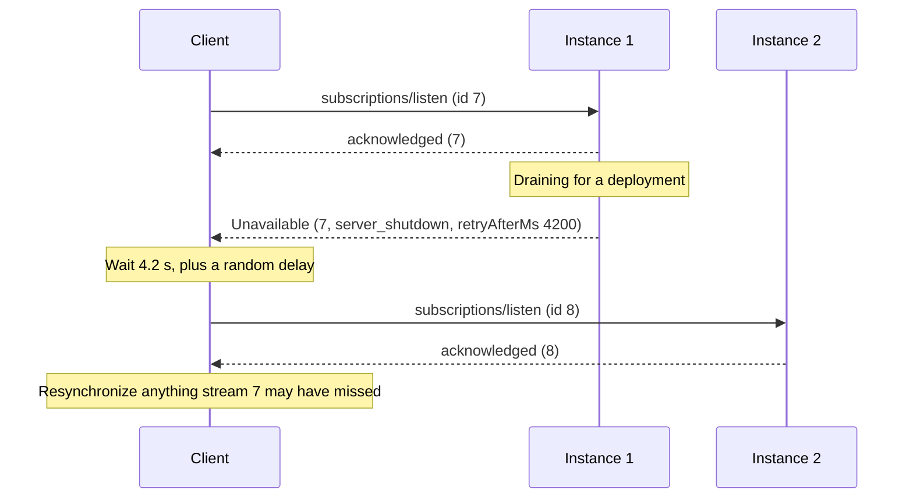

# SEP-XXXX: Asynchronous Errors

- **Status**: Draft
- **Type**: Standards Track
- **Created**: 2026-11-06
- **Author(s)**: Ramjot Singh (@RamjotSingh)
- **Sponsor**: None (seeking sponsor)
- **PR**: TBD
- **Related**: [transports-wg#62][issue-62] (discussion); [transports-wg#67][pr-67], whose review asked for this generalization; [SEP-2663][sep-2663] (Tasks); [SEP-3415][sep-3415] (Events)

## Abstract

An MCP server can fail an operation after it has accepted it: a `subscriptions/listen` stream after its acknowledgment, a tool call whose response is already streaming, a task after its creation, an event stream after it started. By then the server can no longer refuse the request, and the specification gives it no way to say why the operation ended or what the client should do next. When a server restarts, every stream it holds closes, and no client can tell whether to reconnect at once, wait, or give up. When a long tool call is cut off, the client cannot tell whether repeating it is safe.

This SEP defines asynchronous errors:

- **Where they are delivered.** As the final response to a long-lived request, or to a request whose response is already under way, and, in extensions, as the error of a failed task or of a subscription's termination signal. Each is an ordinary JSON-RPC error object.
- **What they say.** Four members of the error's `data`, usable with any error code: `reason`, a machine-readable cause; `retryable`, whether repeating the operation can succeed and is safe; `retryAfterMs`, how long to wait first; and `correlationId`, an identifier that the user can quote to the server's operator, who can then find the failure in the server's logs.
- **A new error for transient conditions.** `Unavailable` reports a condition on the server's side that a later attempt can overcome: the server is shutting down or restarting, is overloaded, has kept the operation as long as it allows, or depends on a system that is down. Other conditions, such as a client that reads too slowly or an account whose allowance is used up, keep the codes that describe them, and carry the same members.

The error that [transports-wg#67][pr-67] proposes for streams that end for authorization reasons, `AuthorizationEnded`, was the first asynchronous error. Its reviewers asked for the same pattern for other reasons and other operations. This SEP generalizes it, so that `AuthorizationEnded` can be defined on top of this proposal.

## Motivation

### Servers fail operations they have already accepted

Several MCP operations outlive the moment at which a server can refuse them:

- A `subscriptions/listen` stream is acknowledged, then runs for hours. A server that ends it, for example during shutdown, SHOULD send the completion result ([Subscriptions: Graceful Closure][subs-graceful]), which says only that the subscription ended for an operational reason.
- A request whose response is streamed, such as a long `tools/call` on Streamable HTTP, has sent its HTTP status before it finishes. A server that is drained for a deployment halfway through can no longer answer `503` with `Retry-After`, and response streams cannot be resumed ([Streamable HTTP][streamable-http]). The client sees the stream close, and cannot tell whether the tool ran.
- A task ([SEP-2663][sep-2663]) is created, then fails later. A server that loses it in a restart, or stops it because a system it depends on is down, marks it `failed` with an error, but nothing in the error says whether submitting the request again is safe, or when to try.
- An event subscription ([SEP-3415][sep-3415]) ends with a termination signal whose error carries free text in `data.reason`, such as `"Access revoked"`.

In each case, the client receives an error, or nothing, and has to guess.

### Guessing is expensive

A client that repeats everything amplifies an overload, and can repeat side effects: it submits again a tool call that had already sent an email. A client that repeats nothing loses its subscriptions in every routine deployment. A fleet of clients that all reconnect when a server restarts arrives at the new instance in the same second.

Other protocols tell the client what to do. WebSocket close codes distinguish a service restart from a request to try again later ([IANA: WebSocket Close Code Number Registry][ws-close-codes]). HTTP/2's `GOAWAY` frame tells a client which requests the server never processed, and can therefore be retried safely ([RFC 9113, section 6.8][rfc9113-goaway]). MQTT 5 names why a server disconnects a client, from "Server shutting down" to "Maximum connect time", so that the client can "decide whether to retry the connection, and how long it should wait before retrying" ([MQTT 5.0, section 3.14.2.1][mqtt5-disconnect]). The Language Server Protocol, from which MCP takes some of its inspiration, lets a server cancel a request that supports it and, for diagnostics, say whether the client should send it again ([LSP 3.17: Error Codes][lsp-errors]). [Prior art](#prior-art) lists more.

### Users have nothing to quote

When an operation fails and the user asks the server's operator what happened, the operator has to find the failure in the server's logs. Nothing the client holds identifies it: the JSON-RPC `id` of a request, which is also the subscription ID of a stream, is chosen by the client, and clients reuse the same small numbers.

### A pattern that already works for authorization

[transports-wg#67][pr-67] proposes `AuthorizationEnded`, an error that ends a stream with a `reason` telling the client whether to refresh its token, involve the user, or stop. Reviewers asked for the same shape for reasons other than authorization, and for operations other than subscriptions where a server can no longer answer with a synchronous error.

## Specification

The key words "MUST", "MUST NOT", "REQUIRED", "SHALL", "SHALL NOT", "SHOULD", "SHOULD NOT", "RECOMMENDED", "NOT RECOMMENDED", "MAY", and "OPTIONAL" in this document are to be interpreted as described in BCP 14 ([RFC 2119][rfc2119], [RFC 8174][rfc8174]) when, and only when, they appear in all capitals.

### 1. Scope and definitions

An asynchronous error is a JSON-RPC message, and its meaning does not depend on the transport. On Streamable HTTP, it travels in a response stream whose HTTP status, `200`, has already been sent. The token errors that the Authorization specification defines over HTTP are unchanged ([Authorization: Error Handling][auth-errors]). On stdio, a server that is about to exit can send asynchronous errors for the operations it holds; repeating them afterwards requires the client to start the server again.

- **Accepted operation**: an operation that the server has begun to serve, and can no longer refuse with a synchronous error. In the core protocol, a `subscriptions/listen` stream after its acknowledgment, and a request whose response the server has committed, for example by sending the HTTP status and headers of a streamed response on Streamable HTTP. In extensions, for example, a task after its creation, an event stream after its confirmation, and a webhook subscription after it was created.
- **Asynchronous error**: a JSON-RPC error object (`code`, `message`, and `data`) by which a server reports that an accepted operation ended or failed, delivered as [section 2](#2-delivery) describes.
- **Repeating an operation**: sending again the request that started it, with the same parameters: opening a stream again with the same filter, or submitting a request again. Fresh credentials do not make it a different operation.

### 2. Delivery

| Operation                                        | The asynchronous error is                                                                             | Defined in                                                                   |
| ------------------------------------------------ | ----------------------------------------------------------------------------------------------------- | ---------------------------------------------------------------------------- |
| `subscriptions/listen`, after its acknowledgment | The final response to the request, the last message on the stream, in place of the completion result. | This specification                                                           |
| A request whose response is committed            | The response to the request, the last message on its response stream.                                 | This specification                                                           |
| A task                                           | The `error` of the task, whose status becomes `failed`.                                               | The Tasks extension ([section 8](#8-guidance-for-extensions-non-normative))  |
| An event subscription                            | The `error` of its termination signal: a notification, a poll response, or a webhook body.            | The Events extension ([section 8](#8-guidance-for-extensions-non-normative)) |

**Server rules**

1. A server that ends or fails an accepted operation, other than by completing it or because the client cancelled it, SHOULD report it with an asynchronous error, carrying the members of [section 3](#3-members-of-data) that it knows.
2. On `subscriptions/listen`, the server sends the error as the last message on the stream, then closes the stream. It MUST NOT send `notifications/cancelled` for that stream: the response is the end signal on every transport, as the completion result is ([#3348][issue-3348]). If the stream can no longer be written, the server closes it without a response.
3. A server that ends a `subscriptions/listen` stream for a reason that `Unavailable` covers ([section 4](#4-the-unavailable-error)) SHOULD end it with `Unavailable`, not with the completion result, when the client is at the protocol version that defines it. The completion result keeps its meaning: the server ended the subscription for an operational reason, and gives no further guidance.
4. A server that can still answer a request with a synchronous error does so, as today. The members of [section 3](#3-members-of-data) MAY appear in synchronous errors too.

### 3. Members of `data`

An error whose `data` is an object can carry these members, whatever its code:

| Member          | Type    | Meaning                                                                                                                                         |
| --------------- | ------- | ----------------------------------------------------------------------------------------------------------------------------------------------- |
| `reason`        | string  | Why the operation ended or failed, as a token (rule 1). REQUIRED in `Unavailable`, and in other errors whose definitions require it.            |
| `retryable`     | boolean | Whether repeating the operation can succeed, and is safe (rules 2 and 3). Absent means that the server does not say.                            |
| `retryAfterMs`  | integer | The minimum time, in milliseconds, that the client waits before repeating the operation, counted from when it receives the error. Not negative. |
| `correlationId` | string  | An identifier that the server assigns to this occurrence of the error, so that its operator can find it in the server's logs (rule 6).          |

1. A `reason` is a token, not text. Tokens without a `/` are reserved for the MCP specification and its official extensions, and are written in snake case. Others define tokens with a prefix in reverse-DNS form followed by `/`, as MCP does for `_meta` keys: for example, `com.example/maintenance_window`. Human-readable detail goes in `message`.
2. A server sets `retryable: true` only when repeating the operation can succeed, after `retryAfterMs` if given, and does not repeat effects already applied. Operations that only deliver notifications, such as `subscriptions/listen`, apply no effects. For any other request, such as `tools/call`, the server sets `retryable: true` only if it had not started applying the request's effects, or applying them again is safe.
3. A server sets `retryable: false` when repeating the operation will not succeed, for example because what the operation watches no longer exists.
4. A server that ends many operations at once, as when it shuts down, SHOULD vary `retryAfterMs` across them, so that their clients do not all return at the same moment.
5. An error's definition can give these members a narrower meaning, such as a fixed set of reasons, but not a different one. Clients ignore members they do not recognize.
6. A server SHOULD include `correlationId` whenever it records the error in its own logs or traces, with a value that lets its operator find that record. The value is a short string, opaque to the client. A server that uses W3C Trace Context MAY use the trace ID under which it recorded the error. The value MUST NOT contain credentials, personal data, or details that the principal could not learn with a request, such as the names of internal hosts: users copy it into support requests.

### 4. The `Unavailable` error

`Unavailable` (`-32029`) reports that the server cannot serve or continue an operation now, because of a condition on its side that a later attempt can overcome.

| `reason`               | Meaning                                                                                                                                                                                                   | Usual guidance                                                                          |
| ---------------------- | --------------------------------------------------------------------------------------------------------------------------------------------------------------------------------------------------------- | --------------------------------------------------------------------------------------- |
| `server_shutdown`      | The server, or the instance that holds the operation, is shutting down, restarting, or draining, for example during a deployment or scale-in. Another instance, or this one once restarted, can serve it. | `retryable: true`, with a short `retryAfterMs` that varies across operations.           |
| `overloaded`           | The server is shedding load.                                                                                                                                                                              | `retryable: true`, with `retryAfterMs` set to when the server expects to have capacity. |
| `max_duration`         | The operation reached the longest time the server keeps such an operation, for example a maximum lifetime for streams.                                                                                    | `retryable: true`; repeat at once.                                                      |
| `upstream_unavailable` | A system that the operation depends on, such as the source of its notifications or a service a tool calls, is unavailable.                                                                                | `retryable: true`, with `retryAfterMs` set to the server's estimate.                    |

1. `data.reason` is REQUIRED. A server MAY use a reason that an extension or the server itself defines ([section 3](#3-members-of-data), rule 1).
2. For an operation with effects, such as a `tools/call` cut off by a shutdown, the server sets `retryable` from what it knows about the effects ([section 3](#3-members-of-data), rule 2), whatever the reason.
3. A server MAY also answer a request it cannot serve now with `Unavailable`, for the same reasons: for example, a new `subscriptions/listen` request while it drains.
4. A server MUST NOT send `Unavailable` in response to a request whose protocol version predates the revision that defines it. For such a request, it ends the operation as that version defines: a `subscriptions/listen` stream with the completion result, or by closing it without a response, and any other operation with `-32603` (Internal error), whose `data` MAY carry the members of [section 3](#3-members-of-data).
5. A limit or quota that the client or its principal reached is not a condition on the server's side, and is not reported as `Unavailable`. Examples are how many messages the server will queue for a client that reads too slowly, and the allowance of the client's account ([section 5](#5-other-asynchronous-errors)).

### 5. Other asynchronous errors

Other conditions keep the codes that describe them, as in a synchronous error, and carry the members of [section 3](#3-members-of-data). For example:

| Condition                                              | Error                                                 | Members                                                                                                                               |
| ------------------------------------------------------ | ----------------------------------------------------- | ------------------------------------------------------------------------------------------------------------------------------------- |
| The operation's authorization ended                    | `AuthorizationEnded`, proposed in [#67][pr-67]        | Its `reason`.                                                                                                                         |
| The client or its principal reached a limit or quota   | `ResourceExhausted`, proposed in [SEP-3415][sep-3415] | A reason from the table below, when one applies; `retryAfterMs` when the limit resets; `retryable: false` when only using less helps. |
| What the operation watches or acts on no longer exists | `NotFound`, proposed in [SEP-3415][sep-3415]          | `retryable: false`.                                                                                                                   |
| The server no longer supports what the operation needs | `Unsupported`, proposed in [SEP-3415][sep-3415]       | `retryable: false`.                                                                                                                   |
| The server failed unexpectedly                         | `-32603` (Internal error)                             | `retryable` when the server knows it.                                                                                                 |

This specification defines two reasons for `ResourceExhausted`. SEP-3415's `data.limit` can also name the limit, such as the queue that filled.

| `reason`          | Meaning                                                                                                                                                                                                                                                                                                                   | Usual guidance                                                                                                                    |
| ----------------- | ------------------------------------------------------------------------------------------------------------------------------------------------------------------------------------------------------------------------------------------------------------------------------------------------------------------------- | --------------------------------------------------------------------------------------------------------------------------------- |
| `slow_consumer`   | The client did not read the operation's messages as fast as the server produced them, and the server stopped queuing them for it. Notifications may have been lost.                                                                                                                                                       | `retryable: true`; repeat at once, and resynchronize.                                                                             |
| `quota_exhausted` | An allowance tied to the client's account, such as a plan's monthly allowance, prepaid credits, or a trial, is used up or has expired. The operation can continue only after someone with authority over the account acts, for example by paying, upgrading the plan, or raising the quota, or once the allowance renews. | `retryable: false`; or, for an allowance that renews by itself at a known time, `retryable: true` with `retryAfterMs` until then. |

After `quota_exhausted`, a client SHOULD tell the application that the account needs action, not only that the operation ended. New credentials do not restore an allowance, so the error does not start interactive authorization ([section 6](#6-client-behavior), rule 9).

### 6. Client behavior

1. A client that receives an asynchronous error treats the operation as ended. On `subscriptions/listen`, it is the final message on the stream; for a task, its status is terminal.
2. The client acts on the error's code and `reason` when it recognizes them, and otherwise on `retryable` and `retryAfterMs`. When it recognizes neither the code nor the reason, and `retryable` is absent, it MAY re-establish an operation that only delivers notifications, with backoff, as after an unexpected disconnect.
3. Whatever the code or reason, a client MUST NOT automatically repeat a `tools/call`, or any other operation that does more than deliver notifications, unless the error says `retryable: true`. Only the server knows whether it had started applying the operation's effects. The usual guidance for each reason in [section 4](#4-the-unavailable-error) and [section 5](#5-other-asynchronous-errors) describes what a server commonly sends, and does not by itself permit a repeat.
4. After `retryable: false`, the client MUST NOT repeat the operation automatically, and SHOULD report to the application that it ended.
5. After `retryable: true`, the client MAY repeat the operation, but MUST NOT do so before `retryAfterMs` has elapsed. It SHOULD add a random delay, so that clients whose operations ended together do not return together, and SHOULD back off exponentially, with a limit on attempts, while the operation keeps failing for the same reason.
6. A client MAY treat a `retryAfterMs` longer than it is willing to wait as `retryable: false`.
7. After re-establishing an operation that delivers notifications, the client SHOULD resynchronize the state it derives from them, as after any unexpected disconnect; for example, by listing tools, prompts, or resources again, or by reading subscribed resources again.
8. A client SHOULD keep `correlationId` with the error in its own logs, and SHOULD make it available to the user, for example in the error's details, so that the user can quote it to the server's operator. It does not interpret the value.
9. An asynchronous error MUST NOT by itself start interactive authorization, whatever its code or reason. Errors defined for authorization say what a client may do instead.
10. `message` is diagnostic text from the server. A client SHOULD NOT present it to the user as an instruction from the client.

### 7. Schema changes

Additions to `schema/draft/schema.ts`:

```typescript
/**
 * The server cannot serve or continue an operation now, because of a
 * condition on its side that a later attempt can overcome. `data.reason`
 * says which.
 *
 * @category Errors
 */
export const UNAVAILABLE = -32029;

/**
 * Members that the `data` of any error can carry, saying why an operation
 * ended or failed, whether and when to repeat it, and how the server's
 * operator can find it in the server's logs.
 *
 * @category Errors
 */
export interface AsynchronousErrorData {
  /**
   * Why the operation ended or failed, as a token. Tokens without a "/" are
   * reserved for the MCP specification and its official extensions; others
   * have a reverse-DNS prefix, such as "com.example/maintenance_window".
   */
  reason?: string;
  /**
   * Whether repeating the operation can succeed and is safe. Absent: the
   * server does not say.
   */
  retryable?: boolean;
  /**
   * The minimum time, in milliseconds, to wait before repeating the
   * operation, counted from when the client receives the error.
   *
   * @minimum 0
   */
  retryAfterMs?: number;
  /**
   * An identifier that the server assigns to this occurrence of the error,
   * so that its operator can find it in the server's logs. Opaque to the
   * client, which shows it to the user to quote in support requests.
   */
  correlationId?: string;
}

/**
 * Why a server reports Unavailable. Clients treat unrecognized values
 * according to `retryable` and `retryAfterMs`.
 *
 * @category Errors
 */
export type UnavailableReason =
  | "server_shutdown"
  | "overloaded"
  | "max_duration"
  | "upstream_unavailable"
  | string;

/**
 * Sent when the server cannot serve or continue an operation now. For an
 * accepted operation, it is the operation's asynchronous error.
 *
 * @category Errors
 */
export interface UnavailableError extends Omit<JSONRPCErrorResponse, "error"> {
  error: Error & {
    code: typeof UNAVAILABLE;
    data: AsynchronousErrorData & { reason: UnavailableReason };
  };
}

/**
 * Why a server reports ResourceExhausted, the code for limits that SEP-3415
 * proposes, when one of these applies. Clients treat unrecognized values
 * according to `retryable` and `retryAfterMs`.
 *
 * @category Errors
 */
export type ResourceExhaustedReason =
  "slow_consumer" | "quota_exhausted" | string;
```

`-32029` is provisional: it is the first code in the range reserved for the MCP specification ([Overview: Error Codes][overview-errors]) after the five that [SEP-3415][sep-3415] requests and the one that [transports-wg#67][pr-67] requests. The final number is assigned when the SEP is accepted.

### 8. Guidance for extensions (non-normative)

Tasks and the Events extension already have a place for an error when an operation ends: a failed task's `error`, and an event subscription's termination signal. Neither can say what the client should do next; the members of [section 3](#3-members-of-data) add that without a schema change. Core `subscriptions/listen` streams have no such place; [section 2](#2-delivery) and [transports-wg#67][pr-67] add it.

**Tasks.** A task that fails after its creation already reports an error ([SEP-2663: Task Status][sep-2663-status]), and the members of [section 3](#3-members-of-data) fit in it without a schema change:

- A server that stops a task for a reason other than the outcome of the work reports it as `failed`, with an error that says why: `Unavailable` with `server_shutdown` when it lost the task in a restart, or with `upstream_unavailable` when a system that the work needs is down. `cancelled` then keeps meaning a cancellation that the client asked for.
- `retryable: true` tells the client that submitting the original request again is safe: the work had not started, or repeating it does not repeat its effects.
- Whether a task should stop when its caller's authorization ends is an open question in the Tasks extension ([ext-tasks#11][ext-tasks-11]). A task that stops for that reason can report `AuthorizationEnded`.

**Events.** SEP-3415's termination signal and `notifications/events/error` already carry a JSON-RPC error object ([SEP-3415: Subscription Termination][sep-3415-termination]). With the members of [section 3](#3-members-of-data):

- A push stream that ends during a deployment ends with `Unavailable`, reason `server_shutdown`, `retryable: true`, and a `retryAfterMs`; the client then resumes with its last cursor.
- A subscription whose access is revoked ends with `Forbidden` and `retryable: false`.
- SEP-3415's examples put free text in `data.reason`, such as `"Access revoked"` and `"Gmail API 503"`. Moving that text to `message`, and using tokens such as `revoked` and `upstream_unavailable` in `reason`, would let clients act on it.
- A webhook body can be read well after it was sent; `retryAfterMs` counts from when the client receives it.

**Other extensions.** An extension that defines a long-lived request, or delivers outside a request, reports asynchronous errors in the same way, and defines prefixed reasons for its own conditions.

### 9. Changes to specification documents

- **Overview** (`basic/index`): add `-32029 Unavailable` to the error code table, and a section on asynchronous errors that defines accepted operations and the members of [section 3](#3-members-of-data).
- **Subscriptions** (`basic/patterns/subscriptions`): in Cancellation and Graceful Closure, state that a server can end a stream with an asynchronous error, that it ends a stream for an operational reason with `Unavailable` at this protocol version, and how clients handle it.
- **Streamable HTTP** (`basic/transports/streamable-http`): state that once a response is committed, errors are JSON-RPC responses on its stream, and that a draining server ends such responses with `Unavailable`.
- **Schema** and **Changelog**: the additions of [section 7](#7-schema-changes).

### 10. Examples

A server is drained for a deployment while a stream is open. It ends the stream, giving as `correlationId` the trace ID under which it logged the shutdown, and the client reopens the stream at another instance behind the same URL:

```json
{
  "jsonrpc": "2.0",
  "id": 7,
  "error": {
    "code": -32029,
    "message": "Server restarting for a deployment",
    "data": {
      "reason": "server_shutdown",
      "retryable": true,
      "retryAfterMs": 4200,
      "correlationId": "0af7651916cd43dd8448eb211c80319c"
    }
  }
}
```



A client calls a `send_invoice` tool, which renders a PDF, emails it to the customer, and records the invoice. The client asked for progress, and the call takes a while, so the server answers with an SSE stream. The server is drained just after the email is sent. Its HTTP status has already gone out, so it ends the stream with `Unavailable`, and says that the call must not be submitted again:

```text
HTTP/1.1 200 OK
Content-Type: text/event-stream

data: {"jsonrpc":"2.0","method":"notifications/progress","params":{"progressToken":"p12","progress":1,"total":3,"message":"Invoice PDF rendered"}}

data: {"jsonrpc":"2.0","method":"notifications/progress","params":{"progressToken":"p12","progress":2,"total":3,"message":"Invoice emailed"}}

data: {"jsonrpc":"2.0","id":12,"error":{"code":-32029,"message":"Server restarting; the invoice email was already sent","data":{"reason":"server_shutdown","retryable":false,"correlationId":"e3b98a4c-1f7d-4a6e-9c55-2d8f6b0e7a13"}}}
```

The client does not submit the call again. It reports to the application that the call stopped after the email was sent, with the `correlationId`, which the user can quote to the server's operator to learn whether the invoice was recorded. Had the server been drained while the call was still waiting for a worker, before the tool started, it would have sent `retryable: true`, and the client could have submitted the call again. For a read-only tool, the server can send `retryable: true` whenever the call is cut off.

A task was lost when its server restarted. `tasks/get` reports:

```json
{
  "jsonrpc": "2.0",
  "id": 15,
  "result": {
    "resultType": "complete",
    "taskId": "786512e2-9e0d-44bd-8f29-789f320fe840",
    "status": "failed",
    "createdAt": "2026-11-06T10:30:00Z",
    "lastUpdatedAt": "2026-11-06T10:41:00Z",
    "ttlMs": 3600000,
    "error": {
      "code": -32029,
      "message": "Task lost when the server restarted",
      "data": { "reason": "server_shutdown", "retryable": true }
    }
  }
}
```

## Rationale

### Report the error on the operation

The error goes where the client already waits for the operation's outcome: the response to its request, or the task's status. A separate channel, such as a server-wide notification, would need routing back to the operation, has nowhere to go in stateless MCP without an open request, and could arrive after the client has already reacted to the stream closing.

### Codes say what happened; `data` says what to do

The MCP specification reserves `-32020` to `-32099` for the codes it defines ([Overview: Error Codes][overview-errors]), and SEP-3415 asks future SEPs to reuse its general-purpose codes rather than define overlapping ones. One code for every asynchronous end would overlap them: a removed event type would be both `NotFound` and the new code. So the code keeps its usual job, naming the condition, whether the error is synchronous or asynchronous, and the members of [section 3](#3-members-of-data) carry what a client needs in order to act, whatever the code. A client that does not recognize a code can still follow `retryable` and `retryAfterMs`. Google's APIs work the same way: a canonical code, refined by `ErrorInfo.reason` ([AIP-193][aip-193]), with the delay in `RetryInfo` ([`error_details.proto`][google-error-details]).

### One new code, for conditions on the server's side

No existing or proposed code says that the server cannot continue right now, but that a later attempt can succeed. `-32603` (Internal error) says that something went wrong, not that waiting will help. Shutdown, overload, a maximum duration, and an unavailable upstream all call for the same action, repeating the operation later, and differ in how soon. One code with a reason covers them, as gRPC's `UNAVAILABLE` does ([gRPC: Status codes][grpc-status]). A limit that the client reached is different: the client has to use less, and the server is healthy. It stays with codes for limits, as gRPC separates `RESOURCE_EXHAUSTED`. A client that reads too slowly has reached such a limit, the number of messages the server will queue for it, so `slow_consumer` is a reason for `ResourceExhausted`, not for `Unavailable`. So is `quota_exhausted`, for an account whose allowance is used up, which usually only someone acting on the account can fix. HTTP reserves `402 Payment Required` for future use ([RFC 9110, section 15.5.3][rfc9110-402]), and APIs that report this today treat it as a quota: OpenAI reports billing and quota errors with the type `insufficient_quota`, and notes that retrying them "won't restore API access" ([OpenAI: Error codes][openai-errors]), and Google's APIs tell `RESOURCE_QUOTA_EXCEEDED` apart from `RATE_LIMIT_EXCEEDED` ([`error_reason.proto`][google-error-reason]).

### Say whether a repeat is safe, not only whether it can succeed

Repeating a stream is always safe; repeating a tool call may send a second email. HTTP/2 draws the same line: requests that the server did not process can be retried even when they are not idempotent ([RFC 9113, section 8.7][rfc9113-reliability]), and gRPC warns that `UNAVAILABLE` alone does not make a non-idempotent call safe to retry. Only the server knows whether it applied a request's effects, so `retryable` carries that knowledge, and clients do not repeat other requests without it. Stripe's API gives the same guidance in a `Stripe-Should-Retry` header, for cases that its status codes do not settle ([Stripe: Low-level error handling][stripe-should-retry]), and Temporal lets the code that fails an activity mark the failure `non_retryable`, or set its `next_retry_delay` ([Temporal: `failure` messages][temporal-failure]). Tool annotations such as `idempotentHint` are hints from the server, and are no substitute.

### A delay, counted from receipt

MCP gives durations in milliseconds, as the Tasks extension does with `ttlMs` and `pollIntervalMs`. HTTP's `Retry-After` gives a date or a delay in seconds ([RFC 9110, section 10.2.3][rfc9110-retry-after]), and the `retry` field of server-sent events a reconnection time in milliseconds ([HTML: Server-sent events][html-sse]). A relative delay needs no agreement between clocks, and counting from receipt errs toward waiting longer when an error is read late, as a polled task or a queued webhook can be. Google's `RetryInfo` counts its delay the same way, from when the client receives the error ([`error_details.proto`][google-error-details]), and Kubernetes errors carry `retryAfterSeconds` in their details ([Kubernetes: `StatusDetails`][k8s-status]). Servers vary the delay across operations, and clients add jitter, because a restart ends many operations at once. The registration of WebSocket close code `1012` (Service Restart) asks clients that reconnect to use "a randomized delay of 5 - 30s", for the case of a service restarting with 100,000 clients connected ([HyBi: registration of 1012][ws-1012]).

### End streams with an error, not with the completion result

For a stream, the completion result could have carried the same guidance as new optional members, which older clients would ignore. But a task, a webhook subscription, and a committed response have no completion result: only an error reaches them. Using the error everywhere gives clients one way to learn why an operation ended. It also matches the meaning: the stream did not end because the subscription was complete, but because the server could not continue it. LSP 3.17 reports a request that the server cancels as `ServerCancelled`, and, for diagnostic requests, says in `retriggerRequest` whether to send it again ([LSP 3.17: Error Codes][lsp-errors]). Clients at earlier protocol versions keep receiving the completion result ([section 4](#4-the-unavailable-error), rule 4).

### Reasons are tokens

A client can branch on a token, but not on text. SEP-3415 shows both: `CallbackEndpointError` puts tokens such as `connection_refused` in `data.reason`, and its `Forbidden` example puts `"Access revoked"` there. Prefixes keep tokens defined outside the specification from colliding, much as Google's `ErrorInfo` qualifies each `reason` with a `domain` ([AIP-193][aip-193]).

### Give the user something to quote

When a user asks a server's operator what happened to an operation, the operator needs to find the failure in the server's logs, and nothing the client holds identifies it:

- The JSON-RPC `id`, which is also the subscription ID of a stream, is chosen by the client, and clients reuse the same small numbers.
- Trace context in `_meta` ([Overview: `_meta`][overview-meta]) identifies a trace only when the client sent one and the server continued it. A failure that happens later, such as a shutdown hours into a stream or a task failing in a background worker, is usually recorded under another trace.
- HTTP response headers, such as Stripe's `Request-Id` ([Stripe: Request IDs][stripe-request-ids]), do not exist on stdio, and the headers of a stream were sent when it opened. A failed task, read with `tasks/get`, or a webhook body arrives in a different HTTP exchange altogether.

So the server names the occurrence in the error itself, as other APIs do. Google's APIs return a `RequestInfo` with a `request_id`: "metadata about the request that clients can attach when filing a bug" ([`error_details.proto`][google-error-details]). The `instance` member of Problem Details "identifies the specific occurrence of the problem" ([RFC 9457, section 3.1.5][rfc9457-instance]). Microsoft Graph returns a `request-id` and the date in its error bodies ([Microsoft Graph: Error responses][graph-errors]). The value is opaque, so a server can use whatever its logs are indexed by, including an OpenTelemetry trace ID. It is called `correlationId`, not `requestId`, which the schema already uses for the JSON-RPC `id`, nor `traceId`, since it need not be a trace ID.

### Members not included

- **Resuming from a position.** Response streams in the core protocol cannot be resumed ([Streamable HTTP][streamable-http]), and `subscriptions/listen` has no cursor, so a client always resynchronizes. SEP-3415's event streams carry their own cursors, and signal gaps with `truncated`.
- **Reconnecting elsewhere.** MQTT 5 (`Use another server`, with a `Server Reference`), AMQP 1.0 (`amqp:connection:redirect`), and Twitch EventSub (`reconnect_url`) can send a client to another endpoint ([MQTT 5.0][mqtt5-disconnect], [AMQP 1.0][amqp-errors], [Twitch EventSub][twitch-eventsub]). In MCP, a client presents its access token to the endpoint it connects to, so a redirect from a compromised server could send the token elsewhere; the TypeScript SDK follows HTTP redirects only within the origin of the request ([typescript-sdk#2901][ts-sdk-2901]). Streamable HTTP deployments already route to instances behind one URL.
- **Advance notice.** Gemini's Live API tells a client how much time is left before it closes a connection ([Gemini API: Live API reference][gemini-live]), and Slack Socket Mode can warn about 10 seconds ahead ([Slack: Using Socket Mode][slack-socket]). An asynchronous error is the last message, so notice needs a message that does not end the operation; it is left to a separate proposal.
- **A link to details.** Google's `Help` and Stripe's `request_log_url` give the user a link about the error ([`error_details.proto`][google-error-details], [Stripe: Errors][stripe-errors]). A link that a server chooses, shown to the user by the client, invites phishing; `correlationId` lets the user ask the operator instead.
- **Scope.** Whether a condition affects one operation or every operation that the client has with the server follows from the reason: `server_shutdown` affects all of them, and `max_duration` one.

### Prior art

| System                                                                            | Signal                                                                                                                                                                    | What it tells the client                                                                                         |
| --------------------------------------------------------------------------------- | ------------------------------------------------------------------------------------------------------------------------------------------------------------------------- | ---------------------------------------------------------------------------------------------------------------- |
| WebSocket ([RFC 6455][rfc6455-close], [IANA][ws-close-codes])                     | Close codes `1001` Going Away and `1011` Internal Error; `1012` Service Restart, `1013` Try Again Later, and `1014`, for an invalid response from an upstream server      | Why the server closed the connection; after `1012`, reconnect after a randomized delay ([registration][ws-1012]) |
| HTTP/2 ([RFC 9113][rfc9113-goaway])                                               | `GOAWAY` with the last stream identifier that the server might have processed; `REFUSED_STREAM`                                                                           | Which requests were not processed, and can be retried safely                                                     |
| HTTP ([RFC 9110][rfc9110-retry-after], [RFC 6585][rfc6585])                       | `503` and `429` with `Retry-After`                                                                                                                                        | When to try again                                                                                                |
| Stripe ([error handling][stripe-should-retry], [request IDs][stripe-request-ids]) | A `Stripe-Should-Retry` response header; a `Request-Id` header on each response                                                                                           | Whether to retry; an ID to quote to support                                                                      |
| Server-sent events ([HTML][html-sse])                                             | The `retry` field; a response other than `200`, such as `204 No Content`                                                                                                  | The reconnection delay; stop reconnecting                                                                        |
| gRPC ([status codes][grpc-status], [A6][grpc-a6])                                 | `UNAVAILABLE` and `RESOURCE_EXHAUSTED`; the `grpc-retry-pushback-ms` metadata key                                                                                         | A transient condition, to retry with backoff, or a limit; the delay the server asks for                          |
| Google APIs ([AIP-193][aip-193], [`error_details.proto`][google-error-details])   | `ErrorInfo` with `reason` and `domain`; `RetryInfo` with `retry_delay`; `RequestInfo` with `request_id`                                                                   | A machine-readable reason; the minimum delay; an ID to quote when reporting a problem                            |
| OpenAI API ([error codes][openai-errors])                                         | Billing and quota errors with the type `insufficient_quota`                                                                                                               | That retrying will not help; update credits or limits first                                                      |
| MQTT 5 ([OASIS][mqtt5-disconnect])                                                | `DISCONNECT` reason codes, such as `0x8B` Server shutting down, `0x89` Server busy, `0xA0` Maximum connect time, and `0x9C` Use another server, with a `Server Reference` | Why the server disconnected, whether and when to retry, and where to go                                          |
| AMQP 1.0 ([OASIS][amqp-errors])                                                   | Error conditions on `close` and `detach`, such as `amqp:connection:forced` and `amqp:connection:redirect`                                                                 | Why the connection or link ended; where to reconnect                                                             |
| LSP 3.17 ([specification][lsp-errors])                                            | `ServerCancelled` (`-32802`); for diagnostics, `retriggerRequest`                                                                                                         | Whether to send the request again                                                                                |
| ASP.NET Core SignalR ([hub protocol][signalr-protocol])                           | `Close` message with `error` and `allowReconnect`                                                                                                                         | Whether to reconnect                                                                                             |
| Discord Gateway ([close codes][discord-close-codes])                              | Close codes, each documented as reconnectable or not; `Invalid Session`, whose `d` says whether the session can be resumed                                                | Whether to reconnect, and whether to resume                                                                      |
| Pusher Channels ([protocol][pusher-protocol])                                     | Error code ranges `4000`–`4099`, `4100`–`4199`, and `4200`–`4299`                                                                                                         | Do not reconnect with the same parameters; reconnect after a second or more; reconnect at once                   |
| graphql-ws ([protocol][graphql-ws])                                               | An `Error` message for one operation on a shared connection                                                                                                               | That one subscription failed, while the others continue                                                          |
| Kubernetes ([API concepts][k8s-watch], [`StatusDetails`][k8s-status])             | A watch event of type `ERROR`, with `410 Gone`; `retryAfterSeconds` in the details of a `Status` error                                                                    | Clear the cache, list again, then watch again; when to retry                                                     |
| Temporal ([`failure` messages][temporal-failure])                                 | `non_retryable` and `next_retry_delay` on the failure of an activity                                                                                                      | Whether to retry, and when                                                                                       |
| Microsoft Graph ([lifecycle notifications][graph-lifecycle])                      | `reauthorizationRequired`, `subscriptionRemoved`, and `missed`                                                                                                            | Reauthorize the subscription; create it again; resynchronize                                                     |
| Gemini Live API ([reference][gemini-live])                                        | `GoAway` with `timeLeft`; `SessionResumptionUpdate` with `resumable`                                                                                                      | The time left before the connection ends; whether the session can be resumed                                     |
| Twitch EventSub ([WebSocket events][twitch-eventsub])                             | `session_reconnect` with `reconnect_url`, 30 seconds before closing; `revocation` with the subscription's status                                                          | Move to a new connection; why a subscription ended                                                               |
| Slack Socket Mode ([docs][slack-socket])                                          | `disconnect` with a `reason`: `warning`, about 10 seconds ahead, `refresh_requested`, or `link_disabled`                                                                  | That the connection is ending, and why                                                                           |
| NATS ([client protocol][nats-protocol])                                           | `-ERR 'Slow Consumer'`, after which the server closes the connection                                                                                                      | That the client fell behind                                                                                      |

### Alternatives considered

- **One code for every asynchronous end.** Simpler to recognize, but it overlaps the codes that describe each condition ([Codes say what happened](#codes-say-what-happened-data-says-what-to-do)), and says only that the error was asynchronous, which the client already knows from where it arrived.
- **Optional members on the completion result.** Covers streams only ([End streams with an error](#end-streams-with-an-error-not-with-the-completion-result)).
- **Retry guidance encoded in code ranges**, as Pusher does. MCP's code space is small, and allocated one code at a time.
- **HTTP signals.** `503` with `Retry-After` cannot be sent once a response is committed, and MCP's message patterns do not depend on the transport.
- **Problem Details ([RFC 9457][rfc9457]).** An HTTP response format. MCP errors are JSON-RPC error objects, whose `data` already has room for extension members.
- **`notifications/cancelled` from the server.** Its reason is free text for logging, and servers end requests by responding to them ([#3348][issue-3348]).
- **Clients' own retry policies alone.** Clients would still not know whether a repeat is safe, or when the server can serve again.
- **Correlation through `traceparent` or HTTP headers alone.** See [Give the user something to quote](#give-the-user-something-to-quote).

## Backward Compatibility

The changes are additive:

- `Unavailable` is a new code, sent only in response to requests at the protocol version that defines it. Clients at earlier versions see what they see today: the completion result or a closed stream on `subscriptions/listen`, and `-32603` elsewhere.
- The members of [section 3](#3-members-of-data) are optional, and clients that do not recognize them ignore them. Existing errors gain no requirement.
- `AuthorizationEnded` ([transports-wg#67][pr-67]) is unchanged, and can carry the members.
- SEP-3415's `data.reason` would change from text to tokens if its authors adopt the suggestion in [section 8](#8-guidance-for-extensions-non-normative). SEP-3415 is still a draft.

## Security Implications

- **Reconnection storms.** A shutdown ends many operations at once. Servers vary `retryAfterMs` across them, and clients add jitter and back off.
- **Retry loops.** A faulty or malicious server could keep sending `retryable: true` with no delay. Clients back off and limit their attempts whatever the server says, and can treat a delay longer than they will wait as final.
- **Repeated side effects.** A client repeats a request with effects only when the server says that doing so is safe, and treats tool annotations as hints.
- **No prompts.** No asynchronous error starts interactive authorization by itself ([section 6](#6-client-behavior), rule 9), and clients do not present `message` as their own instruction (rule 10).
- **Payment phishing.** `quota_exhausted` says only that the account needs action. The error has no member for a link ([Members not included](#members-not-included)), and a client presents `message` as the server's text, not its own ([section 6](#6-client-behavior), rule 10), so a payment page that a server names reaches the user only as the server's words.
- **Information disclosure.** Reasons are coarse. `message`, prefixed reasons, and `correlationId` must not reveal what the principal could not learn with a request, nor internal details such as the names of upstream hosts. A `correlationId` grants nothing by itself: the operator looks it up in their own logs.
- **No redirects.** The error never names another endpoint, so it cannot send the client's token elsewhere.

## Performance Implications

An asynchronous error is one message, sent instead of the completion result or a bare close. It lets clients wait instead of retrying blindly, and spreads their return after a restart. A server can disconnect a slow consumer rather than buffer for it without bound, and tell it why.

## Reference Implementation

None yet. A prototype is planned on the fork of the TypeScript SDK that prototypes [transports-wg#67][pr-67] (branch `poc/authorization-lifetime`), whose server already ends streams with `AuthorizationEnded`. The server will end streams with `Unavailable` and `server_shutdown` when it closes, and the client will honor `retryable` and `retryAfterMs`.

## Testing Plan

Conformance scenarios, for the [conformance repository][conformance]:

**Server, required**

1. On a graceful shutdown, ends each open `subscriptions/listen` stream of a client at the defining protocol version with `Unavailable` and reason `server_shutdown` as the final response, without sending `notifications/cancelled`.
2. Ends the same streams of a client at an earlier protocol version with the completion result, and never sends `Unavailable` to it.
3. Includes `reason` in every `Unavailable`, and gives `retryAfterMs`, when present, as a non-negative integer.
4. For a `tools/call` cut off after the tool started applying its effects (in the test harness, a tool that records its side effects), reports `retryable: false` or omits it.

**Server, recommended**

1. Varies `retryAfterMs` across the streams it ends together.
2. Includes `correlationId` in its asynchronous errors.

**Client, required**

1. Does not repeat an operation before `retryAfterMs` has elapsed.
2. Does not repeat an operation automatically after `retryable: false`.
3. Does not submit a `tools/call` again automatically without `retryable: true`, even for a code and reason that it recognizes, such as `Unavailable` with `server_shutdown`.
4. Acts on `retryable` and `retryAfterMs` when it does not recognize the reason.
5. Does not start interactive authorization because of an asynchronous error.

**Client, recommended**

1. Adds a random delay, and backs off while an operation keeps failing for the same reason.
2. Makes `correlationId` available to the application with the error.
3. After `quota_exhausted`, tells the application that the account needs action.

## Open Questions

Each question carries the author's proposed answer.

1. Should `AuthorizationEnded` carry `retryable`? Proposed: yes, as a follow-up to [transports-wg#67][pr-67]: `true` for `token_expiry` and `insufficient_authorization`, whose client actions end in a new attempt, and `false` for `revoked`. A client that does not implement #67 would then still stop after a revocation.
2. Should limits, including `slow_consumer` and `quota_exhausted`, use SEP-3415's `ResourceExhausted`? Proposed: yes, if SEP-3415 is accepted first. Otherwise this SEP defines that code itself, with the meaning SEP-3415 gives it.
3. Should a server be able to warn before it ends an operation, as Gemini's `GoAway` does? Proposed: yes, in a separate proposal, with a message that does not end the operation.
4. Should an error be able to name another endpoint, restricted to the same origin? Proposed: not now. Streamable HTTP deployments route to instances behind one URL.
5. Should `retryAfterMs` be an absolute time, for errors read late such as webhook bodies? Proposed: no. Counting from receipt errs toward waiting.
6. Should the Tasks extension require `failed` with an asynchronous error, rather than `cancelled`, when a server stops a task on its own? Proposed: yes, in the Tasks extension.
7. Should successful results carry a correlation ID too? Proposed: not in this SEP. Results have `_meta`, in which a server can already return one under its own prefix, and a reserved key can follow if implementations converge.

[issue-62]: https://github.com/modelcontextprotocol/transports-wg/issues/62
[pr-67]: https://github.com/modelcontextprotocol/transports-wg/pull/67
[sep-2663]: https://modelcontextprotocol.io/seps/2663-tasks-extension
[sep-2663-status]: https://modelcontextprotocol.io/seps/2663-tasks-extension#task-status
[sep-3415]: https://github.com/modelcontextprotocol/modelcontextprotocol/pull/3415
[sep-3415-termination]: https://github.com/pja-ant/modelcontextprotocol/blob/pja/sep-events-extension/seps/0000-events-extension.md#subscription-termination
[subs-graceful]: https://modelcontextprotocol.io/specification/2026-07-28/basic/patterns/subscriptions#graceful-closure
[streamable-http]: https://modelcontextprotocol.io/specification/2026-07-28/basic/transports/streamable-http
[auth-errors]: https://modelcontextprotocol.io/specification/2026-07-28/basic/authorization#error-handling
[overview-errors]: https://modelcontextprotocol.io/specification/2026-07-28/basic/index#error-codes
[issue-3348]: https://github.com/modelcontextprotocol/modelcontextprotocol/issues/3348
[ext-tasks-11]: https://github.com/modelcontextprotocol/ext-tasks/issues/11
[ts-sdk-2901]: https://github.com/modelcontextprotocol/typescript-sdk/pull/2901
[conformance]: https://github.com/modelcontextprotocol/conformance
[rfc2119]: https://www.rfc-editor.org/rfc/rfc2119
[rfc8174]: https://www.rfc-editor.org/rfc/rfc8174
[ws-close-codes]: https://www.iana.org/assignments/websocket/websocket.xhtml#close-code-number
[ws-1012]: https://mailarchive.ietf.org/arch/msg/hybi/P_1vbD9uyHl63nbIIbFxKMfSwcM/
[rfc6455-close]: https://www.rfc-editor.org/rfc/rfc6455#section-7.4.1
[rfc6585]: https://www.rfc-editor.org/rfc/rfc6585#section-4
[google-error-details]: https://github.com/googleapis/googleapis/blob/master/google/rpc/error_details.proto
[amqp-errors]: https://docs.oasis-open.org/amqp/core/v1.0/os/amqp-core-transport-v1.0-os.html#type-connection-error
[graph-lifecycle]: https://learn.microsoft.com/en-us/graph/change-notifications-lifecycle-events
[graphql-ws]: https://github.com/enisdenjo/graphql-ws/blob/master/PROTOCOL.md#error
[rfc9113-goaway]: https://www.rfc-editor.org/rfc/rfc9113#section-6.8
[rfc9113-reliability]: https://www.rfc-editor.org/rfc/rfc9113#section-8.7
[rfc9110-retry-after]: https://www.rfc-editor.org/rfc/rfc9110#section-10.2.3
[html-sse]: https://html.spec.whatwg.org/multipage/server-sent-events.html
[grpc-status]: https://grpc.io/docs/guides/status-codes/
[grpc-a6]: https://github.com/grpc/proposal/blob/master/A6-client-retries.md
[aip-193]: https://google.aip.dev/193
[mqtt5-disconnect]: https://docs.oasis-open.org/mqtt/mqtt/v5.0/os/mqtt-v5.0-os.html#_Toc3901208
[lsp-errors]: https://microsoft.github.io/language-server-protocol/specifications/lsp/3.17/specification/#errorCodes
[signalr-protocol]: https://github.com/dotnet/aspnetcore/blob/main/src/SignalR/docs/specs/HubProtocol.md
[discord-close-codes]: https://discord.com/developers/docs/topics/opcodes-and-status-codes#gateway-gateway-close-event-codes
[pusher-protocol]: https://pusher.com/docs/channels/library_auth_reference/pusher-websockets-protocol/
[k8s-watch]: https://kubernetes.io/docs/reference/using-api/api-concepts/#efficient-detection-of-changes
[gemini-live]: https://ai.google.dev/api/live
[twitch-eventsub]: https://dev.twitch.tv/docs/eventsub/handling-websocket-events/
[slack-socket]: https://docs.slack.dev/apis/events-api/using-socket-mode
[nats-protocol]: https://docs.nats.io/reference/protocols/client
[rfc9457]: https://www.rfc-editor.org/rfc/rfc9457
[rfc9457-instance]: https://www.rfc-editor.org/rfc/rfc9457#section-3.1.5
[overview-meta]: https://modelcontextprotocol.io/specification/2026-07-28/basic/index#_meta
[graph-errors]: https://learn.microsoft.com/en-us/graph/errors
[stripe-request-ids]: https://docs.stripe.com/api/request_ids
[stripe-should-retry]: https://docs.stripe.com/error-low-level#should-retry
[stripe-errors]: https://docs.stripe.com/api/errors
[temporal-failure]: https://github.com/temporalio/api/blob/master/temporal/api/failure/v1/message.proto
[k8s-status]: https://github.com/kubernetes/apimachinery/blob/master/pkg/apis/meta/v1/types.go
[rfc9110-402]: https://www.rfc-editor.org/rfc/rfc9110#section-15.5.3
[openai-errors]: https://developers.openai.com/api/docs/guides/error-codes
[google-error-reason]: https://github.com/googleapis/googleapis/blob/master/google/api/error_reason.proto
