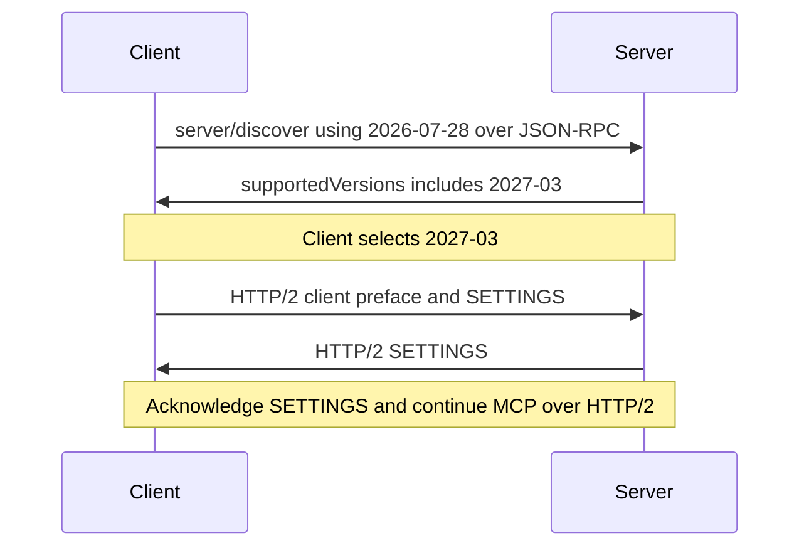
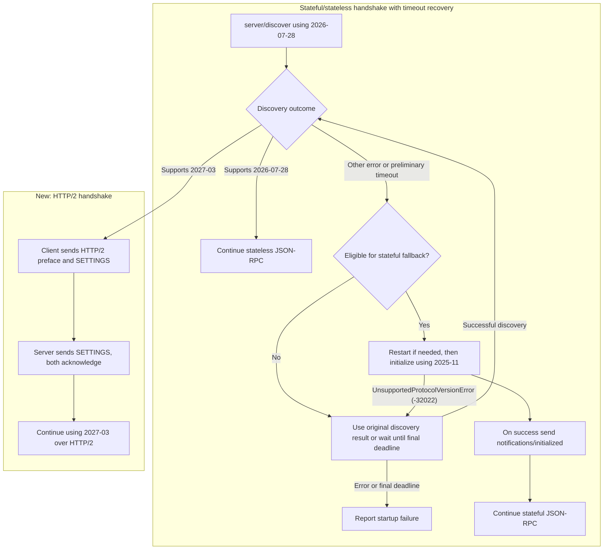

# Proposal: Negotiate HTTP/2 over STDIO through discovery

**Status:** Draft. See the [problem statement](problem-statement.md) and
[communication channel decision](communication-channel-decision.md).

## Proposal

The proposed 2027-03 revision requires HTTP, using HTTP/2 over STDIO locally.
Advertising it in `supportedVersions` lets the client switch directly to HTTP/2
without a separate capability or upgrade RPC.

**Compatible peers negotiate without restarting the server**, retaining existing
`stdio` configuration and avoiding repeated startup effects. Servers supporting
2027-03 must accept JSON-RPC `server/discover` using `2026-07-28` as a bootstrap
exception, even if they do not serve ordinary requests at that older version.
The full HTTP/2 binding is separate work.

## Version key

| Version | Behavior on STDIO |
| --- | --- |
| **2025-11 — stateful** | JSON-RPC with `initialize` and `notifications/initialized`. |
| **2026-07 — stateless** | JSON-RPC with discovery and per-request metadata. |
| **2027-03 — HTTP/2** | Stateless MCP over HTTP/2, with JSON-RPC discovery available during migration. |

These are shorthand labels for `2025-11-25`, `2026-07-28`, and a proposed future
revision. **2027-03 is a placeholder, not an assigned specification version.**
Wire messages use full revision identifiers.

**Prefer the newest mutually supported version found by discovery:** 2027-03, then
2026-07, then 2025-11. JSON-RPC bootstrap discovery uses `2026-07-28`; its result
selects the version for subsequent requests. A 2025-11-only client starts with
`initialize`.

## Handshake

After discovery selects 2027-03, the client sends the standard
[HTTP/2 preface][http2] and SETTINGS. The preface selects framing; subsequent
requests declare 2027-03 through [per-request metadata][versions].

Like [HTTP/1.1 Upgrade][upgrade], this changes the protocol on an existing
connection at a message boundary. Advertising 2027-03 commits the server to
accepting a valid HTTP/2 preface at any later JSON-RPC message boundary.
There is no additional accept/reject exchange: the preface commits the switch.
This is allowed after initialization or application requests, not just at startup.

Before sending the preface, the client must finish all pending JSON-RPC exchanges.
The server must keep accepting JSON-RPC until the preface arrives, and flush all
responses, including their final LF bytes, before switching. This includes both
responses when discovery and fallback `initialize` overlap, whichever finishes
first. No JSON-RPC output may follow the switch.

Validate the preface before sending SETTINGS. Preserve partial reads and
buffered bytes during parser handoff. During bootstrap, send no unsolicited
stdout messages; diagnostics stay on stderr.

## Backward compatibility

**HTTP** means only 2027-03, **STDIO** means only 2026-07 and/or 2025-11,
and **Both** means 2027-03 plus at least one older version. For example:

| Client supports | Server supports | Selected version | Result |
| --- | --- | --- | --- |
| 2027-03, 2026-07, 2025-11 | 2027-03, 2026-07, 2025-11 | 2027-03 | Switch to HTTP/2. |
| 2027-03, 2026-07, 2025-11 | 2026-07, 2025-11 | 2026-07 | Continue stateless JSON-RPC. |
| 2026-07, 2025-11 | 2027-03, 2026-07, 2025-11 | 2026-07 | Continue stateless JSON-RPC. |
| 2027-03, 2026-07, 2025-11 | 2025-11 | 2025-11 | Fall back to stateful initialization. |
| 2025-11 | 2027-03, 2026-07, 2025-11 | 2025-11 | Initialize directly. |
| 2027-03 | 2026-07, 2025-11 | None | Report incompatibility. |

The [existing handshake][stdio] selects stateless JSON-RPC or stateful
initialization. The new handshake adds HTTP/2 after discovery. Choose the newest
version both peers support; no shared version means incompatibility. The diagram
shows initial selection; either JSON-RPC path may later switch to HTTP/2.

- **Version error:** [`UnsupportedProtocolVersionError`][version-error] (`-32022`)
  lists the server's versions in `error.data.supported`. Rejecting the fixed
  `2026-07-28` discovery probe is a bootstrap incompatibility, not evidence of
  a stateful server. Report it without falling back to `initialize`. Other
  recognized stateless-protocol errors also do not trigger stateful fallback.
- **Stateful fallback:** an unrecognized discovery error can trigger
  initialization if the client supports 2025-11. A timeout follows the rules
  below; silence alone does not prove the server is stateful.
- **Two deadlines:** at a preliminary deadline, the client may send one fallback
  `initialize` with a different request ID, keeping discovery pending. At a
  later, fixed final deadline, fail any unfinished startup. Do not extend that
  deadline when sending fallback or receiving a late response.
- **Initialization result:** if `initialize` returns `-32022`, use the original
  discovery result, or keep waiting for it on the same process until the final
  deadline. Hold discovery responses until initialization resolves. If both
  requests fail, fail startup. If initialization succeeds, send
  `notifications/initialized` and continue stateful operation. Late discovery
  can still inform a later upgrade. Other initialization errors fail startup
  without sending `notifications/initialized`.
- **Stateful sessions:** timeout fallback can select an older version on a slow
  server. A later transport upgrade is allowed, but the proposal still needs to
  define what happens to the 2025-11 session when switching to stateless 2027-03.
  Changing framing alone does not define how session state is handled.
- **Restart scope:** reuse the process when possible. Some stateful servers exit
  or cannot initialize after discovery; restart them and send `initialize`
  first. The original discovery request cannot survive a restart. Bound retries
  and retain an explicit initialization-first option. HTTP/2 negotiation itself
  does not require a restart.

## Failure rules

- Query the running process rather than cached discovery. Keep late discovery
  responses on a live connection; discard results from a failed or replaced
  connection.
- Once the client sends any preface bytes, it cannot return to JSON-RPC on those
  pipes. Invalid or truncated prefaces, EOF, or HTTP/2 startup failure close the
  connection. Bound discovery and HTTP/2 startup waits.

## Removing negotiation later

A client supporting only 2027-03 can skip JSON-RPC discovery and send the HTTP/2
preface and SETTINGS immediately. Servers supporting 2027-03 must accept this.
An older-only server will fail or time out, but the peers have no shared version
anyway. MCP version selection still happens over HTTP.

Before adoption, validate same-process switching, both response orders during
fallback, late discovery after initialization succeeds or fails, final deadlines,
fragmented prefaces, combined reads, and switching after ordinary JSON-RPC
exchanges in two SDKs.

[stdio]: https://modelcontextprotocol.io/specification/2026-07-28/basic/transports/stdio#backward-compatibility
[versions]: https://modelcontextprotocol.io/specification/2026-07-28/basic/versioning
[http2]: https://www.rfc-editor.org/rfc/rfc9113.html#section-3.4
[version-error]: https://modelcontextprotocol.io/specification/2026-07-28/schema#unsupportedprotocolversionerror
[upgrade]: https://www.rfc-editor.org/rfc/rfc9110.html#section-7.8
