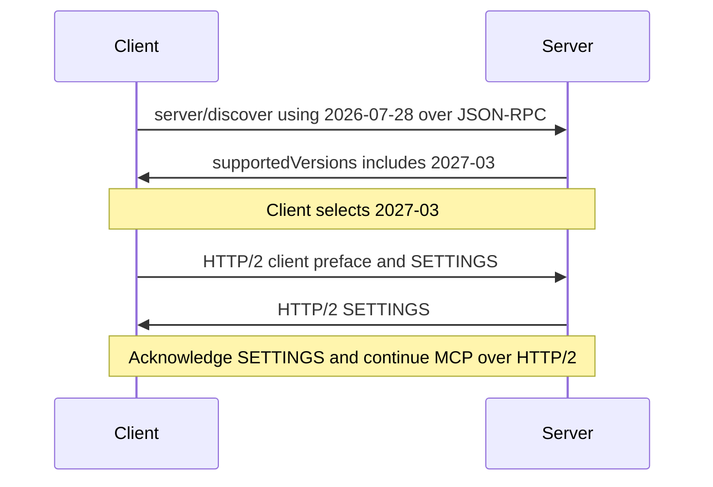
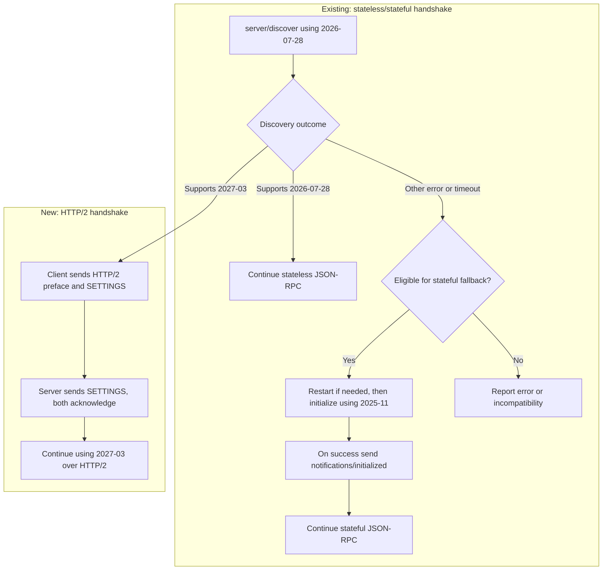

# Proposal: Negotiate HTTP/2 over STDIO through discovery

**Status:** Draft. See the [problem statement](problem-statement.md) and
[communication channel decision](communication-channel-decision.md).

## Proposal

The proposed 2027-03 revision requires HTTP, using HTTP/2 over STDIO locally.
Advertising it in `supportedVersions` lets the client switch directly to HTTP/2
without a separate capability or upgrade RPC.

**Compatible peers negotiate without restarting the server**, retaining existing
`stdio` configuration and avoiding repeated startup effects. Servers supporting
2027-03 must accept JSON-RPC `server/discover` using `2026-07-28` as a bootstrap
exception, even if they do not serve ordinary requests at that older version.
The full HTTP/2 binding is separate work.

## Version key

| Version | Behavior on STDIO |
| --- | --- |
| **2025-11 — stateful** | JSON-RPC with `initialize` and `notifications/initialized`. |
| **2026-07 — stateless** | JSON-RPC with discovery and per-request metadata. |
| **2027-03 — HTTP/2** | Stateless MCP over HTTP/2, with JSON-RPC discovery available during migration. |

These are shorthand labels for `2025-11-25`, `2026-07-28`, and a proposed future
revision. **2027-03 is a placeholder, not an assigned specification version.**
Wire messages use full revision identifiers.

**Clients always prefer the newest mutually supported version:** 2027-03, then
2026-07, then 2025-11. JSON-RPC bootstrap discovery uses `2026-07-28`; its result
selects the version for subsequent requests. A 2025-11-only client starts with
`initialize`.

## Handshake

After discovery selects 2027-03, the client sends the standard
[HTTP/2 preface][http2] and SETTINGS. The preface selects framing; subsequent
requests declare 2027-03 through [per-request metadata][versions].

HTTP-capable servers recognize JSON-RPC or the HTTP/2 preface at startup.
When discovery is used, flush its response and terminating LF before accepting
the preface. Validate the preface before sending SETTINGS. Advertising 2027-03
alone never switches framing.

Switch only before initialization or application requests, with no pending
exchanges. Preserve partial reads and buffered bytes when handing the preface
to HTTP/2. During bootstrap, send no unsolicited stdout messages; diagnostics
stay on stderr.

## Backward compatibility

**HTTP** means only 2027-03, **STDIO** means only 2026-07 and/or 2025-11,
and **Both** means 2027-03 plus at least one older version. For example:

| Client supports | Server supports | Selected version | Result |
| --- | --- | --- | --- |
| 2027-03, 2026-07, 2025-11 | 2027-03, 2026-07, 2025-11 | 2027-03 | Switch to HTTP/2. |
| 2027-03, 2026-07, 2025-11 | 2026-07, 2025-11 | 2026-07 | Continue stateless JSON-RPC. |
| 2026-07, 2025-11 | 2027-03, 2026-07, 2025-11 | 2026-07 | Continue stateless JSON-RPC. |
| 2027-03, 2026-07, 2025-11 | 2025-11 | 2025-11 | Fall back to stateful initialization. |
| 2025-11 | 2027-03, 2026-07, 2025-11 | 2025-11 | Initialize directly. |
| 2027-03 | 2026-07, 2025-11 | None | Report incompatibility. |

The [existing handshake][stdio] selects stateless JSON-RPC or stateful
initialization. The new handshake adds HTTP/2 after discovery. Choose the newest
version both peers support; no shared version means incompatibility.

- **Version error:** [`UnsupportedProtocolVersionError`][version-error] (`-32022`)
  lists the server's versions in `error.data.supported`. Rejecting the fixed
  `2026-07-28` discovery probe is a bootstrap incompatibility, not evidence of
  a stateful server. Report it without falling back to `initialize`. Other
  recognized stateless-protocol errors also do not trigger stateful fallback.
- **Stateful fallback:** an unrecognized discovery error or timeout can trigger
  initialization if the client supports 2025-11. Some stateful servers exit or
  cannot initialize after a discovery probe; restart them and send `initialize`
  first. Reuse the process when it remains usable. On initialization failure,
  stop without sending `notifications/initialized`.
- **Restart scope:** HTTP/2 negotiation does not require a restart. Restarting
  for stateful compatibility may repeat process startup effects; bound retries
  and retain an explicit initialization-first option. Existing sessions are
  not migrated.

## Failure rules

- Query the running process rather than cached discovery. Ignore late discovery
  responses after stateful fallback begins.
- Once the client sends any preface bytes, it cannot return to JSON-RPC on those
  pipes. Invalid or truncated prefaces, EOF, or HTTP/2 startup failure close the
  connection. Bound discovery and HTTP/2 startup waits.

## Removing negotiation later

A client supporting only 2027-03 can skip JSON-RPC discovery and send the HTTP/2
preface and SETTINGS immediately. Servers supporting 2027-03 must accept this.
An older-only server will fail or time out, but the peers have no shared version
anyway. MCP version selection still happens over HTTP.

Before adoption, validate same-process switching, older-version fallback,
fragmented prefaces, combined reads, and failures in two SDKs.

[stdio]: https://modelcontextprotocol.io/specification/2026-07-28/basic/transports/stdio#backward-compatibility
[versions]: https://modelcontextprotocol.io/specification/2026-07-28/basic/versioning
[http2]: https://www.rfc-editor.org/rfc/rfc9113.html#section-3.4
[version-error]: https://modelcontextprotocol.io/specification/2026-07-28/schema#unsupportedprotocolversionerror
