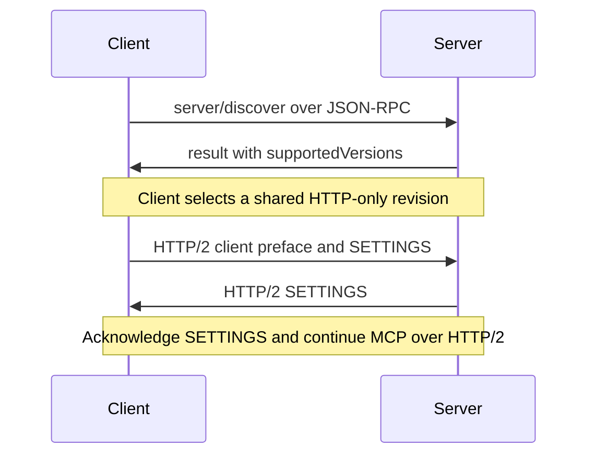
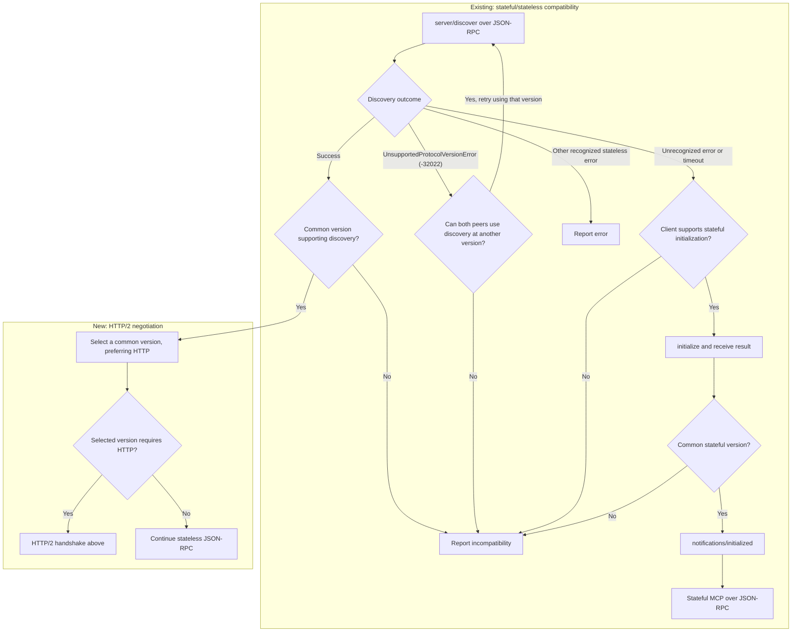

# Proposal: Negotiate HTTP/2 over STDIO through discovery

**Status:** Draft. See the [problem statement](problem-statement.md) and
[communication channel decision](communication-channel-decision.md).

## Proposal

The new MCP revision requires HTTP, using HTTP/2 over STDIO locally. Advertising
it in `supportedVersions` lets the client switch directly to HTTP/2 without a
separate capability or upgrade RPC.

**Compatible peers negotiate without restarting the server**, retaining existing
`stdio` configuration and avoiding repeated startup effects. The new revision
must allow JSON-RPC `server/discover` as a bootstrap exception; ordinary requests
require HTTP. The full HTTP/2 binding is separate work.

## Handshake

After receiving the complete discovery result, the client sends the standard
[HTTP/2 preface][http2] and SETTINGS. The preface selects framing; subsequent
requests declare the chosen MCP revision through [per-request metadata][versions].

HTTP-capable servers recognize either JSON-RPC or the HTTP/2 preface at startup.
When discovery is used, the server flushes its response and terminating LF
before accepting the preface. It validates the preface before sending
SETTINGS. Advertising a revision alone never switches framing.

Switch only before initialization or application requests, with no pending
exchanges. Preserve partial reads and buffered bytes when handing the preface
to HTTP/2; it is a byte sequence, not a JSON line. During bootstrap, the server
sends no unsolicited stdout messages. Diagnostics stay on stderr.

## Backward compatibility

Describe peers by their supported revisions: **HTTP** supports HTTP-only
revisions, **STDIO** supports older JSON-RPC revisions, and **Both** supports
both groups. These are descriptions, not wire fields. HTTP also uses stdin and
stdout and still implements discovery during migration.

Prefer HTTP when a shared HTTP revision exists. Each matrix outcome requires
a shared revision within that group; otherwise the peers are incompatible.

| Client / Server | HTTP | STDIO | Both |
| --- | --- | --- | --- |
| HTTP | HTTP | Incompatible | HTTP |
| STDIO | Incompatible | STDIO | STDIO |
| Both | HTTP | STDIO | Prefer HTTP, otherwise STDIO |

The [existing compatibility flow][stdio] chooses between stateless discovery
and stateful initialization. This proposal adds a transport choice after
successful discovery; it does not change the initialization handshake.

- **Unsupported revision:** [`UnsupportedProtocolVersionError`][version-error]
  (`-32022`) means the server does not support the requested MCP version.
  `error.data.supported` lists the server's supported versions. The client
  retries discovery using a listed version that it also supports and that
  supports discovery, or reports incompatibility if none exists. This is version
  selection within the stateless protocol, not a fallback to `initialize`.
  Other recognized stateless-protocol errors also do not trigger that fallback.
- **Stateful fallback:** older servers may return errors other than `-32601`
  (Method not found), or stay silent. Fallback must account for both.
- **Initialization:** legacy clients may send `initialize` directly. A server
  supporting a shared legacy revision accepts it; an HTTP-only server rejects
  it. On failure, stop without sending `notifications/initialized`. Established
  sessions are not migrated.
- **Process reuse:** fallback reuses the process when possible. Some older
  servers exit on discovery, so retain an explicit legacy startup option.

## Failure rules

- When using discovery, query the running process rather than a cache. Ignore
  late discovery responses after legacy fallback begins.
- Once the client sends any preface bytes, it cannot return to JSON-RPC on those
  pipes. Invalid or truncated prefaces, EOF, or HTTP/2 startup failure close the
  connection. Bound discovery and HTTP/2 startup waits.

## Removing negotiation later

When a client supports only HTTP revisions, it can skip JSON-RPC discovery and
send the HTTP/2 preface and SETTINGS immediately. HTTP and Both servers must
accept this at startup. A STDIO-only server will fail or time out, but the peers
have no shared revision anyway. MCP version selection still happens over HTTP.

Before adoption, validate same-process switching, older-version fallback,
fragmented prefaces, combined reads, and failures in two SDKs.

[stdio]: https://modelcontextprotocol.io/specification/2026-07-28/basic/transports/stdio#backward-compatibility
[versions]: https://modelcontextprotocol.io/specification/2026-07-28/basic/versioning
[http2]: https://www.rfc-editor.org/rfc/rfc9113.html#section-3.4
[version-error]: https://modelcontextprotocol.io/specification/2026-07-28/schema#unsupportedprotocolversionerror
