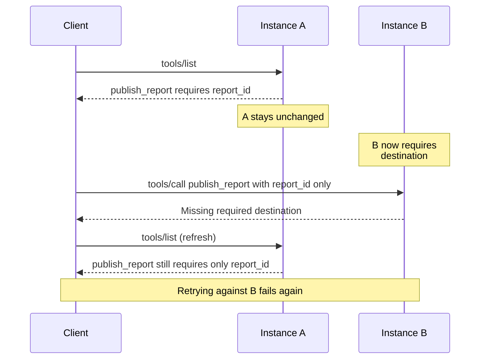

# Problem Statement: Primitive Versioning

- **Status:** Draft
- **Author:** [@kurtisvg](https://github.com/kurtisvg)

MCP services update their tools, prompts, and resources while clients still use earlier definitions. Requests identify a primitive by name or URI, but carry no standard reference to the definition the client used to prepare them. As a result, servers cannot reliably distinguish an outdated definition from a bad call, and refreshing does not always resolve the mismatch.

## Problem

### Three rollout scenarios

| Change                                        | What the client discovered                                    | What goes wrong                                                                                                                                                      |
| --------------------------------------------- | ------------------------------------------------------------- | -------------------------------------------------------------------------------------------------------------------------------------------------------------------- |
| **Change an existing tool**                   | `publish_report` requires only `report_id`.                   | An updated instance also requires `destination`, so the client's previously valid call fails.                                                                        |
| **Add a new tool**                            | An updated instance lists `preview_report`.                   | The call reaches an old instance that does not recognize it. Clients with older lists do not know the new tool exists.                                               |
| **Replace a tool with several smaller tools** | `publish_report` prepares, validates, and publishes a report. | The tool is removed in favor of `create_draft`, `validate_report`, and `publish_draft`. The old call fails; using the replacements requires a new sequence of calls. |

Consider the added `destination` argument. Discovery and execution can reach different instances during the rollout:

Both instances sit behind the same MCP endpoint. B knows that `destination` is required, but cannot reliably tell whether the client used the earlier definition or simply omitted the argument. Refreshing can return A's old definition again, so retrying against B fails for the same reason.

For a tool replaced by several others, even a successful refresh does not repair the original call. The client must plan the new workflow and pass results between calls. Identifying a mismatch does not explain how to translate the old operation into the new sequence.

### Changes beyond argument validation

Some changes cause no validation error. If a tool's `delay` changes from seconds to milliseconds, with an updated description, the old arguments still validate but produce an unintended result. Changes to output schemas or advertised formats can likewise leave clients unable to use a result as expected.

Names affect lookup independently of argument shape. A rename is a removal and an addition from the client's perspective unless the old name remains supported. A tool can also be removed without a replacement, leaving the client unable to complete its plan. The same applies to prompt names and resource URIs.

Not every change is breaking. An optional argument with a compatible default may leave existing calls unaffected. In a catalog with thousands of entries, refreshing the whole list after one unrelated change can be expensive even when the pending operation is unaffected.

### Prompts and resource templates

A user fills in a form for `release_notes(version)` while the prompt gains a required `audience` argument. A client builds a URI from `reports://{report_id}` before the template changes to `reports://{workspace}/{report_id}`. Both requests use definitions that were valid when discovered but may no longer work when submitted.

### Required capabilities and request context

A tool may start requiring elicitation. Definitions can also differ between discovery and execution because of authorization, capabilities, protocol version, or project configuration. For example, discovery may use project-scoped definitions that omit `project_id`, while execution uses an unscoped configuration that requires it.

These are sources of definition mismatches. This statement does not define capability negotiation or cache-key selection. A tool that always required an unsupported capability presents a separate problem: refreshing cannot give the client that capability.

### Deployments behind gateways

One endpoint can combine tools from several services that deploy independently. A gateway's catalog may advertise a definition before the backend handling the request supports it, or continue advertising it after support is removed. Rollbacks can cause the same mismatch.

### Why caching alone is not enough

TTLs are freshness hints, and notifications cannot prevent a change between discovery and use. Even refreshing before every call cannot ensure the next instance supports the returned definition. See the [caching specification](https://modelcontextprotocol.io/specification/2026-07-28/server/utilities/caching).

Prepared work can also outlive the client's own cache. An agent may build a call and pause for approval while a background refresh replaces the cached definition. Updating the cache does not change the definition used to prepare that call.

Discovery can overlap a change too: page one may come from the old catalog and page two from the new one. Separately, an earlier refresh response may arrive after a later one, leaving the client unsure which definitions to keep.

## Requirements

A solution needs to:

- Let the service identify the definition used to prepare a request, including when the client's cache has since refreshed. A prepared call must not silently be relabeled as using a newer definition.
- Let the service handle a compatible request, route it to a compatible instance, or reject it before running the operation.
- Keep compatible calls and calls to unrelated primitives working while signaling when clients should refresh, including to discover additions.
- Distinguish “succeeded, refresh afterward” from “rejected, did not run,” so a client does not repeat an operation with side effects.
- Give clients a clear definition-mismatch error, distinct from invalid arguments or execution failures, so they can refresh and decide whether to rebuild the call, replan, or stop.
- Let clients detect mixed catalog pages and avoid letting delayed responses undo a completed refresh.
- Provide equivalent behavior across transports, including those without HTTP headers.

## Open questions

The design still needs to decide:

- Whether to identify individual definitions, whole catalogs, or both.
- Which fields matter, including descriptions, metadata, and localized text.
- Who decides compatibility and how long earlier definitions remain supported.
- Whether to include `server/discover` instructions, which can affect calls even when primitive definitions are unchanged.

The identifier format and wire behavior belong in a proposal. The [March 2027 roadmap](https://github.com/modelcontextprotocol/transports-wg/blob/main/roadmaps/2027-March.md#1-toolprimitive-versioning) and [#57](https://github.com/modelcontextprotocol/transports-wg/pull/57) cover versioning and rollouts. [#31](https://github.com/modelcontextprotocol/transports-wg/pull/31) covers discovering capability requirements, including cases where nothing changed and the client never supported the tool.
